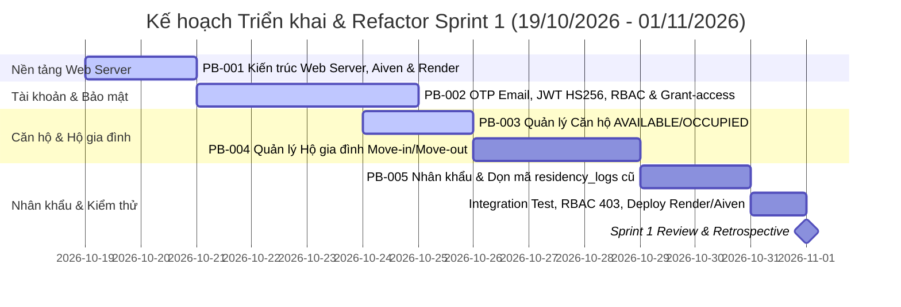

# 📋 KẾ HOẠCH CHI TIẾT SPRINT 1 (SPRINT 1 BACKLOG & EXECUTION PLAN)

> **Dự án:** Hệ thống Quản lý Chung cư BlueMoon — Phiên bản Web Server (v1.0)  
> **Môn học:** Nhập môn Công nghệ Phần mềm (IT3180) - SoICT, Đại học Bách Khoa Hà Nội  
> **Đơn vị thực hiện:** Nhóm 8 (Lớp 172881) — PM: **Hoàng Phúc Hưng** (`202416216`)  
> **Thời gian Sprint 1:** 19/10/2026 – 01/11/2026 (14 ngày)  
> **Tài liệu tham chiếu:** [agile_plan.md](./agile_plan.md) (đồng bộ từ `Nhom-8-Ke-hoach-du-an-Agile-BlueMoon-Web-v2.2.xlsx` & `Nhom-8-Khai-pha-yeu-cau-BlueMoon-Web-v2.1.xlsx`)  
> **Trạng thái Sprint:** 🟡 **In Progress (Đang triển khai & Refactor theo kiến trúc Web Server v1.0)**

> [!NOTE]
> Trên kế hoạch tổng thể trong [agile_plan.md](./agile_plan.md), mốc Sprint 1 được ghi nhận hoàn thành `21/21 SP`. Tài liệu `sprint1.md` này phản ánh **hiện trạng mã nguồn thực tế trong repository** và chi tiết các đầu việc cần refactor/bổ sung để đạt 100% kiến trúc Web Server v1.0 và Definition of Done (8 tiêu chí).

---

## 🎯 1. TỔNG QUAN, MỤC TIÊU & PHÂN CÔNG SPRINT 1

### 1.1. Mục tiêu cốt lõi (Sprint Goal)

> **"Khởi tạo và vận hành hoàn chỉnh nền tảng kiến trúc Web Server (ReactJS + TailwindCSS, Spring Boot + Spring Security, MySQL Aiven, CI/CD Render), triển khai đầy đủ phân hệ Tài khoản & Bảo mật (Đăng ký OTP email, BCrypt + JWT HS256 24h, Quên/Đổi mật khẩu, RBAC `ADMIN`/`RESIDENT`, duyệt tài khoản & Grant-access), và xây dựng hoàn chỉnh nghiệp vụ Quản lý Căn hộ – Hộ gia đình (Move-in/Move-out) – Nhân khẩu kèm Soft Delete và Audit Log."**

### 1.2. Thông số Sprint 1 (Sprint Metrics)

- **Tổng Story Points cam kết:** `21 SP`
- **Số lượng Backlog Items:** `5 items` (`PB-001` – `PB-005` / `US-001` – `US-005`)
- **Epics liên quan:**
  - `EPIC-01`: Nền tảng Web Server, Tài khoản & Bảo mật
  - `EPIC-02`: Quản lý Căn hộ, Hộ gia đình & Nhân khẩu
- **Hiện trạng đối chiếu codebase thực tế:**
  - 🔄 **In Progress (đã có mã nguồn nền, cần refactor/bổ sung theo `agile_plan.md`):** `17 SP` (`PB-001` 5 SP, `PB-002` 5 SP, `PB-003` 3 SP, `PB-005` 4 SP)
  - 📋 **To Do (chưa tách thực thể & luồng mới):** `4 SP` (`PB-004` 4 SP — Quản lý Hộ gia đình Move-in/Move-out)

### 1.3. Phân công 7 thành viên Sprint 1 (theo `README.md`)

| STT | Họ và tên | MSSV | Vai trò | Hạng mục phụ trách chính trong Sprint 1 |
| :---: | :--- | :---: | :--- | :--- |
| 1 | **Hoàng Phúc Hưng** | `202416216` | **PM / DevOps / Kiến trúc** | `PB-001` (Kiến trúc Monorepo, CI/CD Render, review PR & điều phối Sprint) |
| 2 | **Mai Huy Hoàng** | `202400046` | **Backend Developer** | `PB-001` (MySQL Aiven, Flyway), `PB-002` (Auth, JWT HS256, OTP `email_otps`, Grant-access) |
| 3 | **Đỗ Tràng Minh Quân** | `202416320` | **Backend Developer** | `PB-001` (Error Handling, AOP Audit Log), `PB-002` (RBAC Middleware HTTP 403, SMTP email, Quên mật khẩu) |
| 4 | **Đào An Huy** | `202416223` | **Frontend Developer** | `PB-001` (UI chuẩn Arial 14 Responsive), `PB-002` (Login, Register OTP, Forgot Password, Menu động RBAC) |
| 5 | **Nguyễn Trung Khang** | *(Bổ sung sau)* | **Fullstack Developer** | `PB-003` (Quản lý Căn hộ), `PB-004` (Quản lý Hộ gia đình Move-in/Move-out) |
| 6 | **Nguyễn Đức Quang** | `202416327` | **Fullstack Developer** | `PB-004` (Liên kết tài khoản hộ & UI Hộ gia đình), `PB-005` (Quản lý Nhân khẩu) |
| 7 | **Phạm Ngọc Huy** | *(Bổ sung sau)* | **Fullstack / QA** | `PB-003` (Tìm kiếm/lọc căn hộ), `PB-005` (Validate CCCD 9/12 số, ngày sinh, dọn `residency_logs` cũ & kiểm thử) |

---

## 🔄 2. ĐỐI CHIẾU KIẾN TRÚC CŨ → MỚI (`agile_plan.md` GAP ANALYSIS)

Bảng đối chiếu dưới đây xác định rõ các điểm sai khác giữa mã nguồn hiện có trong repo (xây dựng theo đặc tả cũ) và kiến trúc chuẩn trong [agile_plan.md](./agile_plan.md):

| Khía cạnh | Đặc tả / Code hiện tại trong Repo | Kiến trúc mục tiêu (`agile_plan.md`) | Hành động Refactor / Bổ sung |
| :--- | :--- | :--- | :--- |
| **Phạm vi & SP** | `19 SP` (`PB-016`, `US-014`, `US-001..003`), lịch `18/10/2026` – `01/11/2026` | `21 SP` (`PB-001`..`PB-005` / `US-001`..`US-005`), lịch `19/10/2026` – `01/11/2026` | Đồng bộ danh mục Backlog, Story Points và lịch trình 14 ngày |
| **Hạ tầng & Deploy** | Chạy MySQL local, tài liệu cũ ghi nhầm *Desktop Java*, CORS chỉ mở `localhost:5173` | Web Server deploy FE & BE trên **Render**, MySQL tập trung trên **Aiven** (SSL) | Cấu hình env vars Aiven SSL, pipeline CI/CD Render, CORS động theo domain |
| **Vai trò & RBAC** | 3 role nội bộ: `ROLE_ADMIN`, `ROLE_CASHIER`, `ROLE_RESIDENT_MANAGER` | 4 chủ thể: **Khách**, **Cư dân (`RESIDENT`)**, **Ban quản lý (`ADMIN` — kiêm Kế toán)**, **Hệ thống** | Chuyển enum sang `ADMIN` / `RESIDENT`, bật `@EnableMethodSecurity`, trả **HTTP 403** 100%, dựng menu động RBAC |
| **Xác thực & Tài khoản (`PB-002`)** | Chỉ có Login + Đổi mật khẩu (`AuthController.java`) | Đăng ký + **OTP Email** (`email_otps` băm, 5 phút, $\le 3\text{ s}$), Quên/Đặt lại mật khẩu, BQL tạo tài khoản nội bộ, **duyệt cư dân & Grant-access** | Thêm bảng `email_otps`, Spring Mail SMTP, API register/verify/forgot/reset/grant-access và màn hình FE |
| **Căn hộ & Hộ gia đình (`PB-003`, `PB-004`)** | Gộp `owner_name`, `owner_cccd`, `owner_phone` vào bảng `apartments`; enum `EMPTY`/`OCCUPIED` | Tách bảng `apartments` (enum **`AVAILABLE`/`OCCUPIED`**) và bảng **`households`** (Move-in, Move-out, tài khoản liên kết) | Migration đổi `EMPTY` → `AVAILABLE`, tạo bảng/entity `households`, tách API & UI Move-in/Move-out |
| **Nhân khẩu & Tạm trú (`PB-005`)** | Có bảng `residency_logs` (Tạm trú / Tạm vắng `TAM_VANG`), CCCD `CHAR(12)` gắn `apartment_id` | Gắn `household_id`, validate **CCCD/CMND 9 hoặc 12 số duy nhất**, **ngày sinh $\le$ hiện tại**, chỉ giữ trạng thái *Thường trú / Tạm trú* | Chuyển FK sang `household_id`, sửa regex CCCD 9\|12 số + `@PastOrPresent`; tách bỏ `residency_logs` / `TAM_VANG` khỏi Sprint 1 |
| **Lỗi, Soft Delete, UI & Git** | Chưa tách rõ lỗi CSDL vs validate; thiếu `is_deleted` đồng bộ; UI chưa chuẩn Arial 14; nhánh `feature/fe-*` | Tách biệt lỗi CSDL vs nhập liệu; **Soft Delete + Audit Log** toàn hệ thống; UI Responsive **Arial 14** đen nền trắng (chữ trái, số phải); nhánh `feat/PB-xxx-...` | Chuẩn hóa `GlobalExceptionHandler`, thêm `is_deleted`, chuẩn hóa CSS & áp dụng DoD 8 tiêu chí |

---

## 📊 3. BẢNG THEO DÕI TIẾN ĐỘ SPRINT 1 (SPRINT TRACKING BOARD)

| AT RISK | ITEM | MÔ TẢ NGẮN | EPIC | PHỤ TRÁCH | SP | START | FINISH | TRẠNG THÁI | PHỤ THUỘC & GHI CHÚ |
| :---: | :--- | :--- | :---: | :--- | :---: | :---: | :---: | :---: | :--- |
| 🟢 | **Sprint 1** | **Nền tảng Web Server, Auth/RBAC & Căn hộ – Hộ – Nhân khẩu** | `EPIC-01`, `EPIC-02` | **Nhóm 8 (PM: Hưng)** | **21** | **19/10/2026** | **01/11/2026** | 🟡 **In Progress** | Đồng bộ 5 mục `PB-001`..`PB-005` theo `agile_plan.md` |
| 🟢 | **`PB-001` (`US-001`)** | Khởi tạo kiến trúc Web Server (React/Spring/MySQL Aiven/Render) | `EPIC-01` | Hưng, Hoàng, Quân, An Huy | 5 | 19/10/2026 | 21/10/2026 | 🟡 **In Progress** | Đã xong khung local; còn cấu hình Aiven, Render, tách lỗi CSDL & UI Arial 14 |
| 🟡 | **`PB-002` (`US-002`)** | Tài khoản & Bảo mật (OTP Email, JWT HS256, RBAC, Grant-access) | `EPIC-01` | Hoàng, Quân, An Huy | 5 | 21/10/2026 | 25/10/2026 | 🟡 **In Progress** | Phụ thuộc `PB-001` \| *At Risk:* OTP SMTP $\le 3\text{ s}$ & refactor 3 role → `ADMIN`/`RESIDENT` |
| 🟢 | **`PB-003` (`US-003`)** | Quản lý Căn hộ (`AVAILABLE`/`OCCUPIED`, tìm kiếm/lọc) | `EPIC-02` | Khang, Ngọc Huy | 3 | 24/10/2026 | 26/10/2026 | 🟡 **In Progress** | Phụ thuộc `PB-001`, `PB-002` \| Đã có CRUD cơ bản; cần đổi enum & thêm Soft Delete |
| 🟡 | **`PB-004` (`US-004`)** | Quản lý Hộ gia đình (Move-in, Move-out, liên kết tài khoản) | `EPIC-02` | Khang, Quang | 4 | 26/10/2026 | 29/10/2026 | ⚪ **To Do** | Phụ thuộc `PB-002`, `PB-003` \| *At Risk:* cần migration tách bảng `households` |
| 🟢 | **`PB-005` (`US-005`)** | Quản lý Nhân khẩu (CCCD 9/12 số, ngày sinh, Thường trú/Tạm trú) | `EPIC-02` | Quang, Ngọc Huy | 4 | 29/10/2026 | 01/11/2026 | 🟡 **In Progress** | Phụ thuộc `PB-004` \| Cần nối `household_id`, sửa regex 9\|12 số, dọn `residency_logs` cũ |

---

## 🔍 4. CHI TIẾT TỪNG HẠNG MỤC CÔNG VIỆC (WORK PACKAGES)

### 4.1. `PB-001` (`US-001` | `EPIC-01` | 5 SP): Khởi tạo kiến trúc Web Server

- **Thời gian:** 19/10/2026 – 21/10/2026
- **Trạng thái:** 🟡 **In Progress**
- **Người phụ trách:** Hoàng Phúc Hưng (PM/DevOps), Mai Huy Hoàng (DB/Flyway), Đỗ Tràng Minh Quân (Error Handling/Audit), Đào An Huy (Frontend Layout/Theme)
- **Tiêu chí chấp nhận (AC) & Yêu cầu kiến trúc:**
  - Khởi tạo hoàn chỉnh hệ thống Web Server: ReactJS + TailwindCSS, Java Spring Boot + Spring Security, MySQL tập trung trên **Aiven** và CI/CD deploy trên **Render**.
  - Chuẩn xử lý lỗi tập trung: phân biệt rõ lỗi kết nối/thao tác CSDL với lỗi validate nhập liệu của người dùng.
  - Giao diện Responsive chuẩn: font **Arial 14px** màu đen trên nền trắng, chữ căn trái, số căn phải.
  - Thiết lập khung **Soft Delete** và **Audit Log** dùng chung cho toàn bộ các thao tác quản trị.
- **Nhiệm vụ cụ thể (Subtasks):**
  - [x] **Monorepo & Framework:** Khởi tạo cấu trúc `client/`, `server/`, `database/`, `docs/`; Spring Boot 3.3.4 / Java 21 ([pom.xml](../server/pom.xml)); React 19 + Vite + Tailwind CSS v4 ([package.json](../client/package.json)).
  - [x] **Database & Migration:** Thiết lập Flyway migrations ([V1__init.sql](../server/src/main/resources/db/migration/V1__init.sql), [V2__add_password_management.sql](../server/src/main/resources/db/migration/V2__add_password_management.sql), [V3__enhance_apartments_household.sql](../server/src/main/resources/db/migration/V3__enhance_apartments_household.sql), [V4__sprint1_web_v1_refactor.sql](../server/src/main/resources/db/migration/V4__sprint1_web_v1_refactor.sql)) và cấu hình datasource ([application.yml](../server/src/main/resources/application.yml)).
  - [x] **Audit & Exception nền:** Xây dựng AOP Audit Trail ([AuditLogAspect.java](../server/src/main/java/com/hust/se/bluemoon/aspect/AuditLogAspect.java)) và khung [GlobalExceptionHandler.java](../server/src/main/java/com/hust/se/bluemoon/config/GlobalExceptionHandler.java).
  - [ ] **MySQL Aiven Cloud (Deploy):** Tạo instance MySQL trên Aiven và cấu hình biến môi trường thực tế (`DB_URL`, `DB_USERNAME`, `DB_PASSWORD`, `JWT_SECRET`, `MAIL_*`).
  - [ ] **CI/CD Render (Deploy):** Kết nối repo lên Render theo blueprint [render.yaml](../render.yaml) & [Dockerfile](../server/Dockerfile) (đã cấu hình sẵn CORS động tại [SecurityConfig.java](../server/src/main/java/com/hust/se/bluemoon/config/SecurityConfig.java)).
  - [x] **Chuẩn hóa xử lý lỗi:** Bổ sung handler tách biệt lỗi CSDL (`DataAccessException`, `CannotGetJdbcConnectionException`) với lỗi nhập liệu (`MethodArgumentNotValidException`, `ConstraintViolationException`) trong [GlobalExceptionHandler.java](../server/src/main/java/com/hust/se/bluemoon/config/GlobalExceptionHandler.java).
  - [x] **Chuẩn hóa UI & Soft Delete:** Áp dụng font Arial 14px, màu đen nền trắng, chữ căn trái, số căn phải tại [index.css](../client/src/index.css) và [MainLayout.jsx](../client/src/layouts/MainLayout.jsx); chuẩn hóa cờ `is_deleted` cho mọi bảng nghiệp vụ.

---

### 4.2. `PB-002` (`US-002` | `EPIC-01` | 5 SP): Tài khoản & Bảo mật (OTP, JWT, RBAC, Grant-access)

- **Thời gian:** 21/10/2026 – 25/10/2026
- **Trạng thái:** 🟡 **In Progress** _(At Risk)_
- **Người phụ trách:** Mai Huy Hoàng (Auth/OTP/Grant-access), Đỗ Tràng Minh Quân (RBAC/SMTP/Reset Password), Đào An Huy (UI Auth & Menu động)
- **Tiêu chí chấp nhận (AC):**
  - **Khách:** Đăng ký tài khoản với xác thực **OTP email** (mã OTP lưu dạng băm trong bảng `email_otps`, hết hạn sau **5 phút**, gửi email $\le 3\text{ giây}$); đăng nhập; quên/đặt lại mật khẩu.
  - **Đăng nhập & Phiên:** Mật khẩu băm **BCrypt**; cấp **JWT HS256** hết hạn sau **24 giờ**; hỗ trợ đổi mật khẩu cá nhân (lưu lịch sử mật khẩu).
  - **RBAC (`ADMIN` / `RESIDENT`):** Chặn truy cập trái phép tại Middleware trả **HTTP 403** trong 100% trường hợp; Frontend dựng menu động theo vai trò.
  - **Quản trị tài khoản (`ADMIN`):** BQL tạo tài khoản nội bộ, duyệt tài khoản cư dân mới đăng ký và **gán hộ gia đình (Grant-access)**.
- **Nhiệm vụ cụ thể (Subtasks):**
  - [x] **Auth nền tảng:** API `POST /api/auth/login` và `PUT /api/auth/change-password` ([AuthController.java](../server/src/main/java/com/hust/se/bluemoon/controller/AuthController.java), [AuthService.java](../server/src/main/java/com/hust/se/bluemoon/service/AuthService.java), [JwtTokenProvider.java](../server/src/main/java/com/hust/se/bluemoon/util/JwtTokenProvider.java), [JwtAuthenticationFilter.java](../server/src/main/java/com/hust/se/bluemoon/config/JwtAuthenticationFilter.java)).
  - [x] **UI Đăng nhập & Interceptor:** Trang [Login.jsx](../client/src/pages/Login.jsx), modal đổi mật khẩu tại [MainLayout.jsx](../client/src/layouts/MainLayout.jsx) và Bearer interceptor tại [axiosClient.js](../client/src/api/axiosClient.js).
  - [x] **Refactor RBAC (`ADMIN` / `RESIDENT`):** Migration chuyển [Role.java](../server/src/main/java/com/hust/se/bluemoon/entity/Role.java) và cột `users.role` từ 3 vai trò cũ sang `ADMIN` và `RESIDENT`; bật `@EnableMethodSecurity` và quy tắc phân quyền URL trong [SecurityConfig.java](../server/src/main/java/com/hust/se/bluemoon/config/SecurityConfig.java) đảm bảo trả **HTTP 403** khi sai quyền.
  - [x] **Đăng ký & OTP Email:** Tạo bảng `email_otps` (lưu OTP dạng băm, TTL 5 phút), cấu hình SMTP gửi mail $\le 3\text{ s}$; xây dựng `POST /api/auth/register`, `POST /api/auth/verify-otp`, `POST /api/auth/resend-otp`.
  - [x] **Quên & Đặt lại mật khẩu:** Xây dựng `POST /api/auth/forgot-password` (gửi OTP) và `POST /api/auth/reset-password` (xác thực OTP & cập nhật mật khẩu BCrypt).
  - [x] **Duyệt tài khoản & Grant-access (`ADMIN`):** Bổ sung `email`, `approval_status` (`PENDING`/`APPROVED`/`REJECTED`), `household_id` vào `users`; API `POST /api/admin/users`, `GET /api/admin/users`, `PUT /api/admin/users/{id}/grant-access` kèm `@LogAudit`.
  - [x] **Frontend Auth & Menu động:** Thêm màn hình [Register.jsx](../client/src/pages/Register.jsx), [ForgotPassword.jsx](../client/src/pages/ForgotPassword.jsx), [AdminUsersPage.jsx](../client/src/pages/AdminUsersPage.jsx), [ResidentHomePage.jsx](../client/src/pages/ResidentHomePage.jsx); cập nhật [MainLayout.jsx](../client/src/layouts/MainLayout.jsx) và [App.jsx](../client/src/App.jsx) dựng menu & route động theo RBAC.

---

### 4.3. `PB-003` (`US-003` | `EPIC-02` | 3 SP): Quản lý Căn hộ

- **Thời gian:** 24/10/2026 – 26/10/2026
- **Trạng thái:** 🟡 **In Progress**
- **Người phụ trách:** Nguyễn Trung Khang (Fullstack), Phạm Ngọc Huy (Fullstack/QA)
- **Tiêu chí chấp nhận (AC):**
  - CRUD căn hộ với **mã căn hộ duy nhất** (`UNIQUE`), số tầng, **diện tích $> 0$** ($\text{m}^2$), trạng thái **`AVAILABLE` / `OCCUPIED`**.
  - Tìm kiếm/lọc nhanh theo mã căn hộ, tầng và trạng thái; đáp ứng NFR độ trễ API $\le 200\text{ ms}$, tải trang $\le 2\text{ s}$ với $1.000$ bản ghi.
  - Xóa căn hộ sử dụng **Soft Delete** (không xóa cứng, chặn xóa khi đang `OCCUPIED`) và ghi **Audit Log**.
- **Nhiệm vụ cụ thể (Subtasks):**
  - [x] **Backend & DB nền:** Bảng `apartments` với `area > 0` và `idx_apartment_code`; [Apartment.java](../server/src/main/java/com/hust/se/bluemoon/entity/Apartment.java), [ApartmentController.java](../server/src/main/java/com/hust/se/bluemoon/controller/ApartmentController.java), [ApartmentService.java](../server/src/main/java/com/hust/se/bluemoon/service/ApartmentService.java) (`GET`, `POST`, `PUT`).
  - [x] **Frontend nền:** Giao diện danh sách căn hộ, tìm kiếm và modal thêm/sửa tại [ApartmentsPage.jsx](../client/src/pages/ApartmentsPage.jsx).
  - [x] **Refactor trạng thái & tách thông tin hộ:** Migration đổi [ApartmentStatus.java](../server/src/main/java/com/hust/se/bluemoon/entity/ApartmentStatus.java) từ `EMPTY`/`OCCUPIED` sang **`AVAILABLE`/`OCCUPIED`**; chuyển thông tin chủ hộ sang bảng `households` (`PB-004`).
  - [x] **Soft Delete & Audit Log:** Bổ sung cột `is_deleted`, API `DELETE /api/apartments/{id}` (kiểm tra trạng thái `AVAILABLE` trước khi xóa mềm) và gắn `@LogAudit`.
  - [x] **Tìm kiếm & Lọc nâng cao:** Hỗ trợ filter theo trạng thái (`AVAILABLE`/`OCCUPIED`), tầng và từ khóa trên API & UI.

---

### 4.4. `PB-004` (`US-004` | `EPIC-02` | 4 SP): Quản lý Hộ gia đình (Move-in / Move-out)

- **Thời gian:** 26/10/2026 – 29/10/2026
- **Trạng thái:** ⚪ **To Do** _(At Risk — phụ thuộc migration tách bảng `households`)_
- **Người phụ trách:** Nguyễn Trung Khang (Fullstack), Nguyễn Đức Quang (Fullstack)
- **Hiện trạng repo:** Đã tách hoàn chỉnh bảng & entity [Household.java](../server/src/main/java/com/hust/se/bluemoon/entity/Household.java), API [HouseholdController.java](../server/src/main/java/com/hust/se/bluemoon/controller/HouseholdController.java) và giao diện [HouseholdsPage.jsx](../client/src/pages/HouseholdsPage.jsx).
- **Tiêu chí chấp nhận (AC):**
  - **Chuyển hộ đến (Move-in):** Chỉ cho phép chuyển vào căn hộ ở trạng thái `AVAILABLE`; bắt buộc nhập **CCCD chủ hộ 12 chữ số** hợp lệ; tự động chuyển căn hộ sang `OCCUPIED`.
  - **Chuyển hộ đi (Move-out):** Ghi nhận ngày chuyển đi, cập nhật trạng thái hộ sang `MOVED_OUT`, trả căn hộ về `AVAILABLE` và xử lý liên kết cư dân/tài khoản tương ứng.
  - **Xem tài khoản liên kết hộ:** Hiển thị danh sách tài khoản `RESIDENT` đã được gán quyền vào hộ (Grant-access từ `PB-002`).
  - Toàn bộ thao tác áp dụng Soft Delete và ghi Audit Log.
- **Nhiệm vụ cụ thể (Subtasks):**
  - [x] **Database & Entity:** Migration tạo bảng `households` (`id`, `apartment_id`, `head_name`, `head_cccd` VARCHAR(12), `phone`, `move_in_date`, `move_out_date`, `status` `ACTIVE`/`MOVED_OUT`, `is_deleted`) và khóa ngoại `users.household_id`.
  - [x] **API Move-in:** `POST /api/households/move-in` — kiểm tra căn hộ `AVAILABLE`, validate CCCD chủ hộ 12 số, cập nhật trạng thái căn hộ sang `OCCUPIED` trong cùng transaction, gắn `@LogAudit`.
  - [x] **API Move-out & Tra cứu:** `PUT /api/households/{id}/move-out` (trả căn hộ về `AVAILABLE`), `GET /api/households`, `GET /api/households/{id}/accounts` (xem tài khoản `RESIDENT` liên kết hộ).
  - [x] **Frontend Hộ gia đình:** Xây dựng trang [HouseholdsPage.jsx](../client/src/pages/HouseholdsPage.jsx) với modal Chuyển hộ đến (chỉ chọn căn `AVAILABLE`), nút Chuyển hộ đi có xác nhận, và modal tài khoản liên kết hộ.

---

### 4.5. `PB-005` (`US-005` | `EPIC-02` | 4 SP): Quản lý Nhân khẩu

- **Thời gian:** 29/10/2026 – 01/11/2026
- **Trạng thái:** 🟡 **In Progress**
- **Người phụ trách:** Nguyễn Đức Quang (Fullstack), Phạm Ngọc Huy (Fullstack/QA)
- **Tiêu chí chấp nhận (AC):**
  - CRUD thành viên thuộc hộ gia đình (`household_id`).
  - Validate **CCCD/CMND gồm 9 hoặc 12 chữ số duy nhất** trên toàn hệ thống; **ngày sinh $\le$ ngày hiện tại**.
  - Trạng thái cư trú chuẩn hóa: **Thường trú (`THUONG_TRU`)** / **Tạm trú (`TAM_TRU`)**.
  - Xóa nhân khẩu dùng **Soft Delete** và ghi **Audit Log**.
- **Nhiệm vụ cụ thể (Subtasks):**
  - [x] **Backend & DB nền:** Bảng `residents`, [Resident.java](../server/src/main/java/com/hust/se/bluemoon/entity/Resident.java), [ResidentController.java](../server/src/main/java/com/hust/se/bluemoon/controller/ResidentController.java), [ResidentService.java](../server/src/main/java/com/hust/se/bluemoon/service/ResidentService.java) (`GET`, `POST`, `DELETE` deactivate, kiểm tra trùng CCCD).
  - [x] **Frontend nền:** Danh sách nhân khẩu và modal thêm/sửa nhân khẩu tại [ResidentsPage.jsx](../client/src/pages/ResidentsPage.jsx).
  - [x] **Refactor liên kết hộ:** Chuyển khóa ngoại nhân khẩu từ `apartment_id` sang `household_id` (liên kết `PB-004`), chuẩn hóa `is_deleted` và `@LogAudit`.
  - [x] **Validate nghiệp vụ chuẩn `agile_plan.md`:** Mở rộng cột `cccd_number` sang `VARCHAR(12)` để nhận **9 hoặc 12 chữ số** (`^(\d{9}|\d{12})$`); thêm ràng buộc **ngày sinh $\le$ hiện tại** (`@PastOrPresent`); chuẩn hóa trạng thái cư trú chỉ còn `THUONG_TRU` và `TAM_TRU`.
  - [x] **Hoàn thiện CRUD:** Bổ sung API `PUT /api/residents/{id}` và form chỉnh sửa nhân khẩu trên giao diện.
  - [x] **Dọn mã nguồn cũ (Ngoài phạm vi Sprint 1):** Đã gỡ bỏ bảng `residency_logs` trong `V4__sprint1_web_v1_refactor.sql`, xóa `ResidencyLog.java` / `ResidencyLogRepository.java` / `ResidencyLogRequest.java`, và gỡ modal `TAM_VANG` khỏi giao diện.

---

## 📅 5. LỊCH TRÌNH THỰC HIỆN THEO NGÀY (19/10/2026 – 01/11/2026)

### Chi tiết các mốc ngày làm việc:
- **19/10 – 21/10 (Ngày 1–3):** Hoàn thiện `PB-001` — kết nối MySQL Aiven, cấu hình CI/CD Render, chuẩn hóa `GlobalExceptionHandler` tách lỗi CSDL vs lỗi nhập liệu, chuẩn hóa UI Arial 14 & Soft Delete.
- **21/10 – 25/10 (Ngày 3–7):** Hoàn thiện `PB-002` — refactor RBAC (`ADMIN`/`RESIDENT` trả HTTP 403), bảng `email_otps` + SMTP gửi OTP $\le 3\text{ s}$, luồng Đăng ký/Quên mật khẩu, BQL duyệt tài khoản & Grant-access, menu động FE.
- **24/10 – 26/10 (Ngày 6–8):** Hoàn thiện `PB-003` — migration `EMPTY` → `AVAILABLE`, Soft Delete căn hộ, lọc/tìm kiếm nhanh đạt ngưỡng $\le 200\text{ ms}$.
- **26/10 – 29/10 (Ngày 8–11):** Triển khai `PB-004` — tách bảng `households`, API & UI Move-in (căn `AVAILABLE`, CCCD chủ hộ 12 số), Move-out và xem tài khoản liên kết hộ.
- **29/10 – 31/10 (Ngày 11–13):** Hoàn thiện `PB-005` — nối `household_id`, validate CCCD/CMND 9 hoặc 12 số duy nhất, ngày sinh $\le$ hiện tại, chỉ giữ Thường trú/Tạm trú và dọn luồng `residency_logs` cũ.
- **31/10 – 01/11 (Ngày 13–14):** Freeze code, chạy Unit/Integration Test & test RBAC 403, kiểm thử trên Render + Aiven, họp **Sprint 1 Review & Retrospective**.

---

## 🔒 6. YÊU CẦU PHI CHỨC NĂNG ÁP DỤNG CHO SPRINT 1 (NFR CHECKLIST)

Mọi Pull Request trong Sprint 1 phải đáp ứng các ngưỡng từ [agile_plan.md](./agile_plan.md):

- **Bảo mật (`NFR-AC-01`):**
  - Mật khẩu băm bằng **BCrypt**; phiên đăng nhập dùng **JWT HS256** hết hạn sau **24 giờ**.
  - OTP lưu dạng băm trong bảng `email_otps`, hết hạn sau **5 phút**, gửi email trong $\le 3\text{ giây}$.
  - Chặn truy cập trái phép theo RBAC (`ADMIN` / `RESIDENT`) tại Middleware, trả **HTTP 403** trong 100% trường hợp.
- **Hiệu năng (`NFR-AC-02`):**
  - Độ trễ phản hồi API $\le 200\text{ ms}$.
  - Thời gian tải trang $\le 2\text{ giây}$ với $1.000$ bản ghi.
  - Chịu tải tối thiểu $100$ người dùng đồng thời (CCU).
- **Toàn vẹn & Trải nghiệm (`NFR-AC-03`):**
  - Phân biệt rõ thông báo lỗi kết nối/thao tác CSDL với lỗi nhập liệu của người dùng.
  - Toàn bộ thao tác xóa dữ liệu nghiệp vụ sử dụng **Soft Delete** và ghi **Audit Log**.
  - Giao diện Responsive, font **Arial 14px** màu đen trên nền trắng, chữ căn trái, số căn phải.

---

## 🛡️ 7. QUẢN TRỊ RỦI RO SPRINT 1 (RISK MANAGEMENT)

| Mã Rủi Ro | Hạng mục liên quan | Nguy cơ / Mô tả Rủi ro | Mức độ | Kế hoạch Phòng ngừa & Giảm thiểu (Mitigation Plan) |
| :---: | :--- | :--- | :---: | :--- |
| **RSK-01** | `PB-003`, `PB-004`, `PB-005` | Migration tách bảng `households` khỏi `apartments`, đổi `EMPTY` → `AVAILABLE` và chuyển FK sang `household_id` làm gãy dữ liệu cũ. | **Cao** | Viết script Flyway migration có kiểm tra dữ liệu chuyển đổi, sao lưu seed trước khi chạy trên Aiven và test trên môi trường local trước khi merge. |
| **RSK-02** | `PB-002` | Refactor RBAC từ 3 role sang `ADMIN`/`RESIDENT` làm sót endpoint chưa chặn HTTP 403 hoặc lệch menu động FE. | **Cao** | Bật `@EnableMethodSecurity`, rà soát toàn bộ Controller và viết Integration Test kiểm tra HTTP 403 cho 100% endpoint quản trị. |
| **RSK-03** | `PB-002` | Gửi email OTP qua SMTP vượt ngưỡng 3 giây hoặc bị chặn port/TLS khi deploy trên Render. | **Trung bình** | Dùng SMTP TLS chuẩn với App Password/dịch vụ mail ổn định, cấu hình timeout rõ ràng và xử lý bất đồng bộ hợp lý khi gửi OTP. |
| **RSK-04** | `PB-001`, `PB-005` | Trùng lặp CCCD/CMND (9 hoặc 12 số) khi nhập đồng thời; lỗi kết nối SSL MySQL Aiven hoặc cold start trên Render. | **Trung bình** | Đặt `UNIQUE` constraint cho `cccd_number` tại MySQL và bắt `DataIntegrityViolationException` riêng biệt; cấu hình HikariCP & SSL Aiven chuẩn trong biến môi trường Render. |

---

## ✅ 8. ĐỊNH NGHĨA HOÀN THÀNH (DoD — 8 TIÊU CHÍ) & QUY ƯỚC GIT

### 8.1. Definition of Done (8 tiêu chí chuẩn từ `agile_plan.md`)

Một Backlog Item (`PB-001`..`PB-005`) chỉ được chuyển sang trạng thái **Done** khi đáp ứng đủ 8 tiêu chí:
1. Code đã được Review bởi ít nhất 01 thành viên khác và không còn lỗi compile/lint.
2. Vượt qua Unit Test và Integration Test cho các API / service cốt lõi.
3. Đáp ứng 100% **Acceptance Criteria (`AC`)** tương ứng của User Story.
4. Xử lý lỗi chuẩn: phân biệt rõ lỗi CSDL và lỗi validate nhập liệu.
5. Kiểm tra phân quyền RBAC ở tầng Middleware (trả HTTP 403 khi sai vai trò).
6. Áp dụng Soft Delete và ghi nhận Audit Log đầy đủ với thao tác quản trị.
7. Đạt các ngưỡng hiệu năng NFR ($\le 200\text{ ms}$ API, $\le 2\text{ s}$ tải trang, giao diện Responsive).
8. Deploy chạy ổn định trên môi trường **Render + MySQL Aiven** và pass kiểm thử UAT.

### 8.2. Quy ước làm việc trên Repository

- **Đặt tên nhánh (Branch):**
  - Tính năng mới: `feat/PB-002-tai-khoan-otp-rbac`, `feat/PB-004-quan-ly-ho-gia-dinh`
  - Sửa lỗi: `fix/PB-005-validate-cccd-9-12-so`
- **Commit Message:** Gắn mã Backlog Item ở đầu commit:
  - `feat(PB-002): add email OTP registration and RBAC middleware`
  - `fix(PB-004): enforce AVAILABLE apartment check on move-in`
- **Pull Request (PR):** Ghi rõ mã `PB-xxx` / `US-xxx`, danh sách `AC` đã kiểm thử và yêu cầu tối thiểu 1 reviewer approve trước khi merge vào `develop` / `main`.
