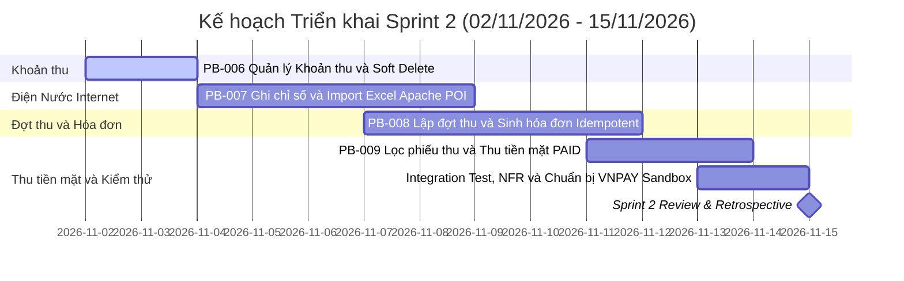

# 📋 KẾ HOẠCH CHI TIẾT SPRINT 2 (SPRINT 2 BACKLOG & EXECUTION PLAN)

> **Dự án:** Hệ thống Quản lý Chung cư BlueMoon — Phiên bản Web Server (v1.0)  
> **Môn học:** Nhập môn Công nghệ Phần mềm (IT3180) - SoICT, Đại học Bách Khoa Hà Nội  
> **Đơn vị thực hiện:** Nhóm 8 (Lớp 172881) — PM: **Hoàng Phúc Hưng** (`202416216`)  
> **Thời gian Sprint 2:** 02/11/2026 – 15/11/2026 (14 ngày)  
> **Tài liệu tham chiếu:** [agile_plan.md](./agile_plan.md) và [sprint1.md](./sprint1.md)  
> **Trạng thái Sprint:** 🟡 **In Progress (Đang triển khai — 0 / 16 SP)**

---

## 🎯 1. TỔNG QUAN, MỤC TIÊU & PHÂN CÔNG SPRINT 2

### 1.1. Mục tiêu cốt lõi (Sprint Goal)

> **"Xây dựng hoàn chỉnh phân hệ Tài chính cốt lõi và Tiện ích Điện/Nước/Internet: Quản lý danh mục khoản thu (Bắt buộc/Tự nguyện, Soft Delete, Audit Log), Ghi nhận & Import chỉ số điện/nước hàng loạt từ Excel (Apache POI), Lập đợt thu & Sinh hóa đơn định kỳ tự động đảm bảo Idempotent cho mọi hộ `ACTIVE`, và Lọc phiếu thu + Xác nhận thanh toán tiền mặt tại quầy kèm cổng tra cứu hóa đơn cho Cư dân."**

### 1.2. Thông số Sprint 2 (Sprint Metrics)

- **Tổng Story Points cam kết:** `16 SP`
- **Số lượng Backlog Items:** `4 items` (`PB-006` – `PB-009` / `US-006` – `US-009`)
- **Epics liên quan:**
  - `EPIC-03`: Quản lý Khoản thu, Đợt thu, Hóa đơn & Thu phí
  - `EPIC-04`: Quản lý Tiện ích Điện / Nước / Internet
- **Hiện trạng triển khai (đồng bộ `agile_plan.md`):**
  - 🔄 **In Progress:** `3 SP` (`PB-006` — Quản lý Khoản thu)
  - 📋 **To Do:** `13 SP` (`PB-007` 5 SP `AT RISK`, `PB-008` 5 SP `AT RISK`, `PB-009` 3 SP)

### 1.3. Phân công 7 thành viên Sprint 2 (theo `README.md`)

| STT | Họ và tên | MSSV | Vai trò | Hạng mục phụ trách chính trong Sprint 2 |
| :---: | :--- | :---: | :--- | :--- |
| 1 | **Hoàng Phúc Hưng** | `202416216` | **PM / DevOps / Kiến trúc** | Điều phối Sprint 2, review PR, kiểm soát Flyway `V5`, tối ưu index CSDL & chuẩn bị tài khoản VNPAY Sandbox cuối Sprint 2 |
| 2 | **Mai Huy Hoàng** | `202400046` | **Backend Developer** | `PB-006` (CRUD Khoản thu, Soft Delete, Audit Log), `PB-008` (Thiết kế bảng đợt thu, hóa đơn, chi tiết hóa đơn & index) |
| 3 | **Đỗ Tràng Minh Quân** | `202416320` | **Backend Developer** | `PB-007` (Apache POI tải template & Import Excel transactional), `PB-008` (Engine sinh hóa đơn định kỳ Idempotent & Unit Test công thức) |
| 4 | **Đào An Huy** | `202416223` | **Frontend Developer** | `PB-006` (UI Quản lý Khoản thu), `PB-007` (UI Ghi chỉ số, tải template & Import Excel báo lỗi theo dòng) |
| 5 | **Nguyễn Trung Khang** | *(Bổ sung sau)* | **Fullstack Developer** | `PB-008` (UI Lập đợt thu, sinh hóa đơn hàng loạt, đóng đợt thu & xem chi tiết hóa đơn) |
| 6 | **Nguyễn Đức Quang** | `202416327` | **Fullstack Developer** | `PB-009` (API & UI lọc phiếu thu theo hộ/trạng thái, xác nhận thu tiền mặt `PAID`, ghi nhận người thu) |
| 7 | **Phạm Ngọc Huy** | *(Bổ sung sau)* | **Fullstack / QA** | `PB-007` & `PB-009` (Cổng Cư dân xem hóa đơn điện/nước & phiếu thu hộ mình, viết Integration Test & kiểm thử NFR/RBAC 403) |

---

## 🧩 2. KẾ THỪA TỪ SPRINT 1 & THIẾT KẾ KIẾN TRÚC MỞ RỘNG

### 2.1. Thành phần kế thừa sẵn có từ Sprint 1

- **Dữ liệu nền tảng:** Bảng `apartments` (cung cấp diện tích `area`), `households` (trạng thái `ACTIVE` / `MOVED_OUT`), `residents` (đếm số nhân khẩu đang cư trú theo hộ), `users` (`ADMIN` / `RESIDENT`, liên kết `household_id`).
- **Hạ tầng & Bảo mật:** Bộ lọc JWT + RBAC tại [SecurityConfig.java](../server/src/main/java/com/hust/se/bluemoon/config/SecurityConfig.java), xử lý lỗi tách biệt CSDL vs nhập liệu tại [GlobalExceptionHandler.java](../server/src/main/java/com/hust/se/bluemoon/config/GlobalExceptionHandler.java), ghi vết tự động tại [AuditLogAspect.java](../server/src/main/java/com/hust/se/bluemoon/aspect/AuditLogAspect.java).
- **Thư viện báo cáo/Excel:** Dependency `poi-ooxml 5.4.0` (Apache POI) đã được khai báo sẵn trong [pom.xml](../server/pom.xml).

### 2.2. Thiết kế Flyway Migration `V5__sprint2_finance_utilities.sql`

- **`fee_items`** *(chuẩn hóa từ `fee_configs` cũ)*: `id`, `fee_name` (`UNIQUE`), `fee_type` (`MANDATORY` / `VOLUNTARY`), `unit_price` (`DECIMAL(15,2) >= 0`), `unit` (`M2` / `PERSON` / `HOUSEHOLD`), `description`, `is_active`, `is_deleted`, `created_at`.
- **`utility_readings`**: `id`, `household_id` (FK `households`), `billing_period` (`YYYY-MM`), `service_type` (`ELECTRICITY` / `WATER` / `INTERNET`), `old_index`, `new_index`, `usage_amount`, `unit_price`, `total_amount`, `is_deleted`, `created_at`.
  - Ràng buộc **`UNIQUE(household_id, billing_period, service_type)`** và kiểm tra `new_index > old_index` (với Điện / Nước).
- **`billing_cycles`**: `id`, `cycle_name`, `billing_period` (`YYYY-MM` `UNIQUE`), `due_date`, `status` (`OPEN` / `CLOSED`), `closed_at`, `created_by` (FK `users`), `is_deleted`, `created_at`.
- **`invoices`**: `id`, `invoice_code` (`UNIQUE`), `billing_cycle_id` (FK `billing_cycles`), `household_id` (FK `households`), `billing_period` (`YYYY-MM`), `service_fee_total`, `utility_fee_total`, `total_amount`, `status` (`UNPAID` / `PAID`), `payment_method` (`CASH` / `VNPAY`), `paid_at`, `collected_by` (FK `users`), `note`, `is_deleted`, `created_at`.
  - Ràng buộc **`UNIQUE(household_id, billing_period)`** chống sinh trùng hóa đơn cùng kỳ thu; đánh index `(status, billing_period)` và `(household_id, status)` phục vụ tra cứu $\le 200\text{ ms}$.
- **`invoice_items`**: `id`, `invoice_id` (FK `invoices`), `item_name`, `item_type` (`FEE` / `UTILITY`), `quantity`, `unit`, `unit_price`, `amount`.

### 2.3. Phân quyền RBAC & Menu động mở rộng

- **`ADMIN`:** Truy cập `/api/fees/**`, `/api/utilities/**`, `/api/billing-cycles/**`, `/api/invoices/**` (chặn `RESIDENT` trả **HTTP 403**). Bổ sung 4 mục menu Sidebar trong `AuthService.buildMenusForRole` & [MainLayout.jsx](../client/src/layouts/MainLayout.jsx):
  - `Khoản thu` (`/fees`)
  - `Điện / Nước / Internet` (`/utilities`)
  - `Đợt thu & Hóa đơn` (`/billing-cycles`)
  - `Thu tiền mặt` (`/invoices`)
- **`RESIDENT`:** Truy cập `/api/resident/utilities` (xem chỉ số/hóa đơn điện nước hộ mình) và `/api/resident/invoices` (xem phiếu thu/hóa đơn & trạng thái thanh toán hộ mình) trên [ResidentHomePage.jsx](../client/src/pages/ResidentHomePage.jsx) hoặc tab con tương ứng.

---

## 📊 3. BẢNG THEO DÕI TIẾN ĐỘ SPRINT 2 (SPRINT TRACKING BOARD)

| AT RISK | ITEM | MÔ TẢ NGẮN | EPIC | PHỤ TRÁCH | SP | START | FINISH | TRẠNG THÁI | PHỤ THUỘC & GHI CHÚ |
| :---: | :--- | :--- | :---: | :--- | :---: | :---: | :---: | :---: | :--- |
| 🟢 | **Sprint 2** | **Khoản thu, Điện/Nước (Import Excel), Sinh hóa đơn & Thu tiền mặt** | `EPIC-03`, `EPIC-04` | **Nhóm 8 (PM: Hưng)** | **16** | **02/11/2026** | **15/11/2026** | 🟡 **In Progress** | Đồng bộ 4 mục `PB-006`..`PB-009` theo `agile_plan.md` |
| 🟢 | **`PB-006` (`US-006`)** | Quản lý Khoản thu (CRUD, Soft Delete, Audit Log) | `EPIC-03` | Hoàng, An Huy | 3 | 02/11/2026 | 04/11/2026 | 🟡 **In Progress** | Khởi động đầu Sprint; làm nền cho công thức tính phí `PB-008` |
| 🔴 | **`PB-007` (`US-007`)** | Quản lý Hóa đơn Điện/Nước/Internet (Ghi chỉ số, Template & Import Excel) | `EPIC-04` | Quân, An Huy, Ngọc Huy | 5 | 04/11/2026 | 09/11/2026 | ⚪ **To Do** | *AT RISK:* File Excel sai định dạng, chỉ số cuối $\le$ đầu, trùng kỳ thu |
| 🔴 | **`PB-008` (`US-008`)** | Lập đợt thu & Sinh hóa đơn định kỳ tự động (Idempotent, đóng đợt thu) | `EPIC-03` | Hoàng, Quân, Khang | 5 | 07/11/2026 | 12/11/2026 | ⚪ **To Do** | Phụ thuộc `PB-006`, `PB-007` \| *AT RISK:* Chống sinh trùng & lệch công thức |
| 🟢 | **`PB-009` (`US-009`)** | Lọc phiếu thu theo hộ/trạng thái & Xác nhận thanh toán tiền mặt (`PAID`) | `EPIC-03` | Quang, Ngọc Huy | 3 | 11/11/2026 | 14/11/2026 | ⚪ **To Do** | Phụ thuộc `PB-008` \| Ghi nhận người thu & cổng tra cứu Cư dân |

---

## 🔍 4. CHI TIẾT TỪNG HẠNG MỤC CÔNG VIỆC (WORK PACKAGES)

### 4.1. `PB-006` (`US-006` | `EPIC-03` | 3 SP): Quản lý Khoản thu

- **Thời gian:** 02/11/2026 – 04/11/2026
- **Trạng thái:** 🟡 **In Progress**
- **Người phụ trách:** Mai Huy Hoàng (Backend), Đào An Huy (Frontend)
- **Tiêu chí chấp nhận (AC):**
  - CRUD danh mục khoản thu với **tên phí duy nhất** (`UNIQUE`), phân loại **Bắt buộc (`MANDATORY`) / Tự nguyện (`VOLUNTARY`)**.
  - Đơn giá $\ge 0$ (`unit_price >= 0`), hỗ trợ đơn vị tính **`m²` (`M2`)**, **`người` (`PERSON`)**, **`hộ` (`HOUSEHOLD`)**.
  - Xóa khoản thu áp dụng **Soft Delete** (`is_deleted = true`) và ghi **Audit Log** đầy đủ mọi thao tác thêm/sửa/xóa.
- **Nhiệm vụ cụ thể (Subtasks):**
  - [ ] **Database & Entity:** Tạo bảng `fee_items` trong `V5__sprint2_finance_utilities.sql`, Entity `FeeItem`, Repository `FeeItemRepository` (kiểm tra trùng tên phí chưa xóa mềm).
  - [ ] **Backend API:** `FeeController` & `FeeService` (`/api/fees`: `GET` lọc từ khóa/loại phí/trạng thái, `POST`, `PUT /{id}`, `DELETE /{id}` Soft Delete kèm `@LogAudit`).
  - [ ] **Frontend UI:** Trang `FeesPage.jsx` với bảng dữ liệu font Arial 14px, chữ căn trái, đơn giá VNĐ căn phải (`tabular-nums`), modal Thêm/Sửa/Xóa mềm.
  - [ ] **QA/Test:** Kiểm thử trùng tên phí (409), đơn giá âm (400 `VALIDATION_ERROR`), RBAC `RESIDENT` bị chặn HTTP 403, kiểm tra bản ghi `audit_logs`.

---

### 4.2. `PB-007` (`US-007` | `EPIC-04` | 5 SP | `AT RISK`): Quản lý Hóa đơn Điện / Nước / Internet

- **Thời gian:** 04/11/2026 – 09/11/2026
- **Trạng thái:** ⚪ **To Do** _(AT RISK)_
- **Người phụ trách:** Đỗ Tràng Minh Quân (Backend/Excel), Đào An Huy (Frontend), Phạm Ngọc Huy (Cư dân & QA)
- **Tiêu chí chấp nhận (AC):**
  - Ghi nhận chỉ số hàng tháng (`YYYY-MM`) cho từng hộ `ACTIVE`; **chỉ số cuối $>$ chỉ số đầu** (`new_index > old_index` đối với Điện/Nước).
  - Cho phép **tải file mẫu Excel (`.xlsx`)** trực tiếp từ giao diện (sinh bằng Apache POI kèm danh sách hộ `ACTIVE` hiện tại).
  - **Import chỉ số hàng loạt từ Excel:** Validate toàn bộ các dòng trước khi commit transaction (`@Transactional` — all-or-nothing); nếu có dòng lỗi (sai mã hộ/căn hộ, chỉ số âm, chỉ số cuối $\le$ đầu, trùng kỳ) thì rollback toàn bộ và trả danh sách lỗi chi tiết theo từng số dòng.
  - **Cư dân (`RESIDENT`):** Xem được danh sách hóa đơn/chỉ số điện, nước, internet của chính hộ mình.
- **Nhiệm vụ cụ thể (Subtasks):**
  - [ ] **Database & Entity:** Tạo bảng `utility_readings` với `UNIQUE(household_id, billing_period, service_type)`, Entity `UtilityReading`, Repository `UtilityReadingRepository`.
  - [ ] **Backend Ghi chỉ số & Template:** API `GET /api/utilities`, `POST /api/utilities`, `PUT /api/utilities/{id}`, `DELETE /api/utilities/{id}` (Soft Delete) và `GET /api/utilities/template` (Apache POI xuất `.xlsx`).
  - [ ] **Backend Import Excel Transactional:** API `POST /api/utilities/import` (`MultipartFile`), kiểm tra định dạng `.xlsx`, parse & validate toàn bộ dòng trước khi lưu, trả lỗi theo dòng nếu có sai sót.
  - [ ] **Cổng Cư dân:** API `GET /api/resident/utilities` chỉ lọc theo `household_id` của user đang đăng nhập.
  - [ ] **Frontend UI:** Trang `UtilitiesPage.jsx` (lọc kỳ thu/loại dịch vụ, modal nhập tay, nút Tải template Excel, modal Import Excel hiển thị bảng lỗi theo dòng) + tab xem chỉ số điện/nước trong `ResidentHomePage.jsx`.
  - [ ] **QA/Test:** Unit & Integration Test cho file Excel hợp lệ, sai định dạng, chỉ số cuối $\le$ đầu, trùng kỳ thu và kiểm tra rollback transaction.

---

### 4.3. `PB-008` (`US-008` | `EPIC-03` | 5 SP | `AT RISK`): Lập đợt thu & Sinh hóa đơn định kỳ tự động

- **Thời gian:** 07/11/2026 – 12/11/2026
- **Trạng thái:** ⚪ **To Do** _(AT RISK)_
- **Người phụ trách:** Mai Huy Hoàng (DB/Entity), Đỗ Tràng Minh Quân (Engine tính phí & Unit Test), Nguyễn Trung Khang (Fullstack UI)
- **Tiêu chí chấp nhận (AC):**
  - Lập đợt thu theo kỳ (`YYYY-MM`) và **tự động sinh hóa đơn** cho tất cả hộ đang ở (`ACTIVE`) trong cùng `@Transactional`.
  - **Công thức tổng hợp:**
    - Phí dịch vụ theo `M2` = `unit_price × apartment.area`
    - Phí theo `PERSON` = `unit_price × số nhân khẩu active của hộ`
    - Phí theo `HOUSEHOLD` = `unit_price × 1`
    - Cộng tổng tiền tiện ích Điện/Nước/Internet (`utility_readings`) của hộ trong kỳ `billing_period`.
  - **Chống tạo trùng kỳ thu (Idempotent):** Không cho phép tạo trùng đợt thu hoặc sinh trùng hóa đơn cho cùng `(household_id, billing_period)` nhờ ràng buộc DB `UNIQUE` và kiểm tra nghiệp vụ.
  - Hỗ trợ **Đóng đợt thu (`CLOSED`)**: Sau khi đóng, khóa sinh thêm/chỉnh sửa hóa đơn của kỳ đó và ghi Audit Log.
- **Nhiệm vụ cụ thể (Subtasks):**
  - [ ] **Database & Entity:** Tạo bảng `billing_cycles`, `invoices`, `invoice_items` với `UNIQUE(household_id, billing_period)`, Entity & Repository tương ứng.
  - [ ] **Engine Sinh hóa đơn Idempotent:** `BillingCycleService` tính tổng phí dịch vụ + điện/nước cho tất cả hộ `ACTIVE`, lưu `invoices` + `invoice_items`, gắn `@LogAudit`.
  - [ ] **Backend API:** `POST /api/billing-cycles`, `POST /api/billing-cycles/{id}/generate-invoices`, `PUT /api/billing-cycles/{id}/close`, `GET /api/billing-cycles`.
  - [ ] **Frontend UI:** Trang `BillingCyclesPage.jsx` — lập đợt thu mới, nút "Sinh hóa đơn tự động" hiển thị tóm tắt số hộ đã sinh & tổng tiền, nút "Đóng đợt thu" có xác nhận, xem chi tiết các khoản trong hóa đơn.
  - [ ] **QA/Test:** Viết Unit Test kiểm chứng công thức tính phí (`M2`, `PERSON`, `HOUSEHOLD` + tiện ích), test gọi sinh hóa đơn 2 lần (Idempotent / chống trùng) và test khóa chỉnh sửa khi `CLOSED`.

---

### 4.4. `PB-009` (`US-009` | `EPIC-03` | 3 SP): Lọc phiếu thu & Xác nhận thanh toán tiền mặt

- **Thời gian:** 11/11/2026 – 14/11/2026
- **Trạng thái:** ⚪ **To Do**
- **Người phụ trách:** Nguyễn Đức Quang (Fullstack), Phạm Ngọc Huy (Cư dân & QA)
- **Tiêu chí chấp nhận (AC):**
  - Lọc danh sách phiếu thu / hóa đơn nhanh theo **hộ gia đình / mã căn hộ**, **kỳ thu** và **trạng thái (`UNPAID` / `PAID`)** với độ trễ $\le 200\text{ ms}$.
  - BQL (`ADMIN`) thực hiện **Xác nhận thanh toán tiền mặt**: chuyển trạng thái từ `UNPAID` → **`PAID`**, đặt `payment_method = CASH`, lưu **người thu (`collected_by`)**, thời gian thu (`paid_at`), và ghi **Audit Log**.
  - Chặn xác nhận trùng nếu hóa đơn đã ở trạng thái `PAID`.
  - **Cư dân (`RESIDENT`):** Xem danh sách hóa đơn và trạng thái đã đóng/chưa đóng của hộ mình.
- **Nhiệm vụ cụ thể (Subtasks):**
  - [ ] **Backend API:** `InvoiceController` & `InvoiceService` (`/api/invoices`: `GET` lọc theo `householdId`/`billingPeriod`/`status`/`keyword`, `GET /{id}` chi tiết `invoice_items`, `PUT /{id}/pay-cash` gắn `@LogAudit`).
  - [ ] **Cổng Cư dân:** API `GET /api/resident/invoices` chỉ trả hóa đơn thuộc `household_id` của user đang đăng nhập (chặn IDOR).
  - [ ] **Frontend UI:** Trang `InvoicesPage.jsx` (bộ lọc đa điều kiện, bảng số tiền VNĐ căn phải, modal xem chi tiết khoản thu, nút "Xác nhận thu tiền mặt") + tab Hóa đơn trong `ResidentHomePage.jsx`.
  - [ ] **QA/Test:** Kiểm thử luồng thu tiền mặt thành công, chặn thu trùng 2 lần (409/400), kiểm tra Audit Log ghi nhận `collected_by`, và test RBAC 403 / IDOR.

---

## 📅 5. LỊCH TRÌNH THỰC HIỆN THEO NGÀY (02/11/2026 – 15/11/2026)

### Chi tiết các mốc ngày làm việc:
- **02/11 – 04/11 (Ngày 1–3):** Hoàn thiện `V5__sprint2_finance_utilities.sql` và hoàn tất `PB-006` (CRUD Khoản thu, Soft Delete, Audit Log, UI bảng VNĐ).
- **04/11 – 09/11 (Ngày 3–8):** Triển khai `PB-007` — ghi chỉ số Điện/Nước/Internet, xuất template `.xlsx` bằng Apache POI, Import Excel transactional & báo lỗi theo dòng, cổng Cư dân xem chỉ số.
- **07/11 – 12/11 (Ngày 6–11):** Triển khai `PB-008` — lập đợt thu, engine sinh hóa đơn tự động Idempotent cho hộ `ACTIVE`, Unit Test công thức, đóng đợt thu `CLOSED`.
- **11/11 – 14/11 (Ngày 10–13):** Triển khai `PB-009` — lọc phiếu thu đa điều kiện, xác nhận thanh toán tiền mặt `PAID` ghi nhận người thu, cổng Cư dân xem lịch sử hóa đơn.
- **13/11 – 15/11 (Ngày 12–14):** Freeze code, chạy toàn bộ Unit/Integration Test, kiểm thử hiệu năng & RBAC 403 trên Render + Aiven, **đăng ký sẵn tài khoản VNPAY Sandbox & kiểm tra callback URL** cho Sprint 3, họp **Sprint 2 Review & Retrospective**.

---

## 🔒 6. YÊU CẦU PHI CHỨC NĂNG ÁP DỤNG CHO SPRINT 2 (NFR CHECKLIST)

Mọi Pull Request trong Sprint 2 phải đáp ứng các ngưỡng từ [agile_plan.md](./agile_plan.md):

- **Bảo mật (`NFR-AC-01`):**
  - Chặn truy cập trái phép theo RBAC (`ADMIN` / `RESIDENT`) tại Middleware, trả **HTTP 403** trong 100% trường hợp.
  - Tài khoản `RESIDENT` chỉ được truy vấn dữ liệu điện/nước và hóa đơn gắn với `household_id` của chính mình (chống IDOR).
- **Hiệu năng (`NFR-AC-02`):**
  - Độ trễ phản hồi API $\le 200\text{ ms}$ (đánh index sớm cho `invoices` và `utility_readings`).
  - Thời gian tải trang $\le 2\text{ giây}$ với $1.000$ bản ghi.
  - Chịu tải tối thiểu $100$ người dùng đồng thời (CCU).
- **Toàn vẹn & Trải nghiệm (`NFR-AC-03`):**
  - Import Excel (`PB-007`) và Sinh hóa đơn (`PB-008`) chạy trong transaction all-or-nothing, phân biệt rõ lỗi CSDL với lỗi nhập liệu / lỗi từng dòng Excel.
  - Toàn bộ thao tác xóa dữ liệu nghiệp vụ sử dụng **Soft Delete** và ghi **Audit Log**.
  - Giao diện Responsive, font **Arial 14px** màu đen trên nền trắng, chữ căn trái, số tiền/chỉ số căn phải (`tabular-nums`, định dạng VNĐ).

---

## 🛡️ 7. QUẢN TRỊ RỦI RO SPRINT 2 (`AT RISK`)

| Mã Rủi Ro | Hạng mục liên quan | Nguy cơ / Mô tả Rủi ro | Mức độ | Kế hoạch Phòng ngừa & Giảm thiểu (Mitigation Plan) |
| :---: | :--- | :--- | :---: | :--- |
| **RSK-01** | `PB-007` (Import Excel) | File Excel sai định dạng cột, chỉ số cuối $\le$ chỉ số đầu hoặc trùng kỳ thu gây sai lệch dữ liệu. | **Cao** | Cung cấp nút tải file template `.xlsx` chuẩn ngay trên giao diện; validate toàn bộ các dòng trước khi commit transaction. |
| **RSK-02** | `PB-008` (Sinh hóa đơn) | Sinh trùng hóa đơn khi bấm nhiều lần hoặc sai lệch công thức tổng hợp phí dịch vụ + điện/nước. | **Cao** | Đặt ràng buộc `UNIQUE(household_id, billing_period)` ở MySQL và viết đầy đủ Unit Test cho công thức tính phí + trường hợp gọi trùng. |
| **RSK-03** | `PB-009` (Thu tiền mặt) | Xác nhận thu tiền mặt 2 lần trên cùng 1 phiếu thu hoặc Cư dân gọi API xem hóa đơn hộ khác (IDOR). | **Trung bình** | Kiểm tra điều kiện trạng thái `UNPAID` trong transaction khi chuyển sang `PAID`; ép lọc `household_id` từ JWT principal ở cổng Cư dân. |
| **RSK-04** | Chuẩn bị `PB-010` (Sprint 3) | Sang Sprint 3 mới đăng ký VNPAY Sandbox hoặc callback URL không gọi được từ ngoài làm chậm tiến độ. | **Trung bình** | Đăng ký tài khoản VNPAY Sandbox và kiểm tra public callback URL trên Render ngay từ cuối Sprint 2 (ngày 13–15/11). |

---

## ✅ 8. ĐỊNH NGHĨA HOÀN THÀNH (DoD — 8 TIÊU CHÍ) & QUY ƯỚC GIT

### 8.1. Definition of Done (8 tiêu chí chuẩn từ `agile_plan.md`)

Một Backlog Item (`PB-006`..`PB-009`) chỉ được chuyển sang trạng thái **Done** khi đáp ứng đủ 8 tiêu chí:
1. Code đã được Review bởi ít nhất 01 thành viên khác và không còn lỗi compile/lint.
2. Vượt qua Unit Test và Integration Test cho các API / service cốt lõi.
3. Đáp ứng 100% **Acceptance Criteria (`AC`)** tương ứng của User Story.
4. Xử lý lỗi chuẩn: phân biệt rõ lỗi CSDL và lỗi validate nhập liệu.
5. Kiểm tra phân quyền RBAC ở tầng Middleware (trả HTTP 403 khi sai vai trò).
6. Áp dụng Soft Delete và ghi nhận Audit Log đầy đủ với thao tác quản trị.
7. Đạt các ngưỡng hiệu năng NFR ($\le 200\text{ ms}$ API, $\le 2\text{ s}$ tải trang, giao diện Responsive).
8. Deploy chạy ổn định trên môi trường **Render + MySQL Aiven** và pass kiểm thử UAT.

### 8.2. Quy ước làm việc trên Repository

- **Đặt tên nhánh (Branch):**
  - `feat/PB-006-quan-ly-khoan-thu`
  - `feat/PB-007-import-excel-dien-nuoc`
  - `feat/PB-008-sinh-hoa-don-dinh-ky`
  - `feat/PB-009-xac-nhan-thu-tien-mat`
- **Commit Message:** Gắn mã Backlog Item ở đầu commit:
  - `feat(PB-006): add CRUD API and soft delete for fee items`
  - `test(PB-007): add validation unit tests for meter reading import`
- **Pull Request (PR):** Ghi rõ mã `PB-xxx` / `US-xxx`, danh sách `AC` đã kiểm thử và yêu cầu tối thiểu 1 reviewer approve trước khi merge vào `develop` / `main`.
