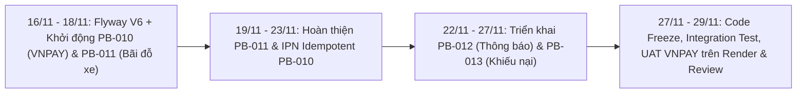

# 📋 KẾ HOẠCH CHI TIẾT SPRINT 3 (SPRINT 3 BACKLOG & EXECUTION PLAN)

> **Dự án:** Hệ thống Quản lý Chung cư BlueMoon — Phiên bản Web Server (v1.0)  
> **Môn học:** Nhập môn Công nghệ Phần mềm (IT3180) - SoICT, Đại học Bách Khoa Hà Nội  
> **Đơn vị thực hiện:** Nhóm 8 (Lớp 172881) — PM: **Hoàng Phúc Hưng** (`202416216`)  
> **Thời gian Sprint 3:** 16/11/2026 – 29/11/2026 (14 ngày)  
> **Tài liệu tham chiếu:** [agile_plan.md](./agile_plan.md), [sprint1.md](./sprint1.md) và [sprint2.md](./sprint2.md)  
> **Trạng thái Sprint:** ⚪ **To Do (Chuẩn bị triển khai — 0 / 19 SP)**

---

## 🎯 1. TỔNG QUAN, MỤC TIÊU & PHÂN CÔNG SPRINT 3

### 1.1. Mục tiêu cốt lõi (Sprint Goal)

> **"Mở rộng hệ sinh thái thanh toán trực tuyến và vận hành tương tác cư dân: Tích hợp Cổng thanh toán VNPAY Sandbox (ký HMAC-SHA512, Webhook/IPN gạch nợ tự động đảm bảo Idempotent, lịch sử giao dịch), Quản lý Phương tiện & Hợp đồng thuê Lốt đỗ xe (`EMPTY`/`OCCUPIED`), Quản lý Thông báo kèm thống kê tỷ lệ đã đọc, và Quản lý Khiếu nại (ticket `Pending` → `Resolved` kèm ảnh minh chứng)."**

### 1.2. Thông số Sprint 3 (Sprint Metrics)

- **Tổng Story Points cam kết:** `19 SP`
- **Số lượng Backlog Items:** `4 items` (`PB-010` – `PB-013` / `US-010` – `US-013`)
- **Epics liên quan:**
  - `EPIC-03`: Quản lý Khoản thu, Đợt thu, Hóa đơn & Thu phí (`PB-010`)
  - `EPIC-04`: Quản lý Tiện ích Điện / Nước / Internet & Bãi đỗ xe (`PB-011`)
  - `EPIC-05`: Thông báo & Khiếu nại Cư dân (`PB-012`, `PB-013`)
- **Hiện trạng triển khai (đồng bộ `agile_plan.md`):**
  - 📋 **To Do:** `19 SP` (`PB-010` 8 SP `AT RISK`, `PB-011` 5 SP, `PB-012` 3 SP, `PB-013` 3 SP)

### 1.3. Phân công 7 thành viên Sprint 3 (theo `README.md`)

| STT | Họ và tên | MSSV | Vai trò | Hạng mục phụ trách chính trong Sprint 3 |
| :---: | :--- | :---: | :--- | :--- |
| 1 | **Hoàng Phúc Hưng** | `202416216` | **PM / DevOps / Kiến trúc** | Điều phối Sprint 3, kiểm soát Flyway `V6`, cấu hình biến môi trường & public IPN callback URL VNPAY trên Render, review PR |
| 2 | **Mai Huy Hoàng** | `202400046` | **Backend Developer** | `PB-011` (CSDL & API Phương tiện, Lốt đỗ xe `EMPTY`/`OCCUPIED`, Hợp đồng thuê lốt & khóa chống race condition), hỗ trợ schema `V6` |
| 3 | **Đỗ Tràng Minh Quân** | `202416320` | **Backend Developer** | `PB-010` (VNPAY Sandbox ký HMAC-SHA512, tạo URL thanh toán, Webhook/IPN đối chiếu checksum & gạch nợ Idempotent, Unit Test) |
| 4 | **Đào An Huy** | `202416223` | **Frontend Developer** | `PB-010` (Nút Thanh toán VNPAY, trang kết quả trả về & lịch sử giao dịch), `PB-011` (UI BQL Quản lý xe, lốt đỗ & hợp đồng thuê) |
| 5 | **Nguyễn Trung Khang** | *(Bổ sung sau)* | **Fullstack Developer** | `PB-011` (Tab Phương tiện & Lốt đỗ cho Cư dân), `PB-012` (API & UI BQL soạn/gửi thông báo theo phạm vi & thống kê tỷ lệ đã đọc) |
| 6 | **Nguyễn Đức Quang** | `202416327` | **Fullstack Developer** | `PB-013` (API & UI Khiếu nại: Cư dân gửi ticket kèm ảnh minh chứng `Pending`, BQL phản hồi & cập nhật `Resolved`) |
| 7 | **Phạm Ngọc Huy** | *(Bổ sung sau)* | **Fullstack / QA** | `PB-012` (Tab Thông báo cho Cư dân đánh dấu đã đọc/chưa đọc), viết `Sprint3IntegrationTest` (IPN Idempotent, RBAC 403, Anti-IDOR) |

---

## 🧩 2. KẾ THỪA TỪ SPRINT 1–2 & THIẾT KẾ KIẾN TRÚC MỞ RỘNG

### 2.1. Thành phần kế thừa sẵn có từ Sprint 1 & Sprint 2

- **Phân hệ Hóa đơn & Công nợ (Sprint 2):** Bảng `invoices` đã có sẵn trường `status` (`UNPAID`/`PAID`), `payment_method` (`CASH`/`VNPAY`), `paid_at`, phục vụ gạch nợ tự động khi nhận IPN VNPAY hợp lệ.
- **Cổng Cư dân & Bảo mật:** [ResidentPortalController.java](../server/src/main/java/com/hust/se/bluemoon/controller/ResidentPortalController.java) lọc cứng theo `household_id` chống IDOR; [SecurityConfig.java](../server/src/main/java/com/hust/se/bluemoon/config/SecurityConfig.java) chặn RBAC HTTP 403; [AuditLogAspect.java](../server/src/main/java/com/hust/se/bluemoon/aspect/AuditLogAspect.java) tự động ghi vết `@LogAudit`.
- **Hạ tầng Multipart & Error Handling:** Cấu hình upload tối đa `5MB` trong [application.yml](../server/src/main/resources/application.yml) và xử lý lỗi chuẩn trong [GlobalExceptionHandler.java](../server/src/main/java/com/hust/se/bluemoon/config/GlobalExceptionHandler.java).

### 2.2. Thiết kế Flyway Migration `V6__sprint3_vnpay_parking_communication.sql`

- **`payment_transactions`** (`PB-010`): `id`, `invoice_id` (FK `invoices`), `txn_ref` (`VARCHAR(64) UNIQUE`), `vnp_transaction_no` (`VARCHAR(64)`), `amount` (`DECIMAL(15,2)`), `bank_code` (`VARCHAR(30)`), `response_code` (`VARCHAR(10)`), `status` (`PENDING` / `SUCCESS` / `FAILED`), `raw_ipn_payload` (`TEXT`), `paid_at` (`DATETIME`), `created_at`.
  - Index `(invoice_id, status)` và `UNIQUE(txn_ref)` giúp tra cứu lịch sử giao dịch và đảm bảo IPN **Idempotent**.
- **`vehicles`** (`PB-011`): `id`, `household_id` (FK `households`), `license_plate` (`VARCHAR(20) UNIQUE`), `vehicle_type` (`MOTORBIKE` / `CAR` / `BICYCLE`), `brand_model` (`VARCHAR(100)`), `color` (`VARCHAR(40)`), `status` (`ACTIVE` / `CANCELLED`), `is_deleted`, `created_at`.
- **`parking_slots`** (`PB-011`): `id`, `slot_code` (`VARCHAR(20) UNIQUE`), `zone` (`VARCHAR(30)`), `vehicle_type` (`MOTORBIKE` / `CAR` / `BICYCLE`), `status` (`EMPTY` / `OCCUPIED`), `monthly_fee` (`DECIMAL(15,2) >= 0`), `is_deleted`, `created_at`.
- **`parking_contracts`** (`PB-011`): `id`, `vehicle_id` (FK `vehicles`), `parking_slot_id` (FK `parking_slots`), `household_id` (FK `households`), `start_date` (`DATE`), `end_date` (`DATE NULL`), `monthly_fee` (`DECIMAL(15,2)`), `status` (`ACTIVE` / `TERMINATED`), `is_deleted`, `created_at`.
- **`notifications`** (`PB-012`): `id`, `title` (`VARCHAR(200)`), `content` (`TEXT`), `scope` (`ALL` / `FLOOR` / `HOUSEHOLD`), `target_value` (`VARCHAR(50) NULL`), `created_by` (FK `users`), `is_deleted`, `created_at`.
- **`notification_recipients`** (`PB-012`): `id`, `notification_id` (FK `notifications`), `user_id` (FK `users`), `is_read` (`TINYINT(1) DEFAULT 0`), `read_at` (`DATETIME NULL`), `UNIQUE(notification_id, user_id)`, index `(user_id, is_read)`.
- **`complaints`** (`PB-013`): `id`, `ticket_code` (`VARCHAR(30) UNIQUE`), `household_id` (FK `households`), `created_by` (FK `users`), `title` (`VARCHAR(200)`), `content` (`TEXT`), `attachment_url` (`VARCHAR(500) NULL`), `status` (`PENDING` / `IN_PROGRESS` / `RESOLVED`), `admin_response` (`TEXT NULL`), `resolved_by` (FK `users`), `resolved_at` (`DATETIME NULL`), `is_deleted`, `created_at`.

### 2.3. Phân quyền RBAC & Menu động mở rộng

- **Public endpoint (không yêu cầu JWT, xác thực bằng chữ ký HMAC-SHA512):**
  - `GET /api/payments/vnpay/ipn` (Webhook IPN từ máy chủ VNPAY).
  - `GET /api/payments/vnpay/return` (Redirect sau khi cư dân thanh toán).
- **`ADMIN`:** Truy cập `/api/payments/transactions/**`, `/api/parking/**`, `/api/notifications/**`, `/api/complaints/**` (chặn `RESIDENT` trả **HTTP 403**). Bổ sung 4 mục menu Sidebar trong `AuthService.buildMenusForRole` & [MainLayout.jsx](../client/src/layouts/MainLayout.jsx):
  - `Giao dịch VNPAY` (`/transactions`)
  - `Phương tiện & Bãi đỗ xe` (`/parking`)
  - `Thông báo cư dân` (`/notifications`)
  - `Tiếp nhận Khiếu nại` (`/complaints`)
- **`RESIDENT`:** Mở rộng `/api/resident/**`:
  - `POST /api/resident/invoices/{id}/vnpay-url` & `GET /api/resident/transactions`
  - `GET/POST/PUT/DELETE /api/resident/vehicles` & `GET /api/resident/parking-contracts`
  - `GET /api/resident/notifications` & `PUT /api/resident/notifications/{id}/read-status`
  - `GET/POST /api/resident/complaints`
  - Nâng cấp [ResidentHomePage.jsx](../client/src/pages/ResidentHomePage.jsx) bổ sung nút **Thanh toán VNPAY** và các tab: *Phương tiện & Đỗ xe*, *Thông báo*, *Khiếu nại*.

---

## 📊 3. BẢNG THEO DÕI TIẾN ĐỘ SPRINT 3 (SPRINT TRACKING BOARD)

| AT RISK | ITEM | MÔ TẢ NGẮN | EPIC | PHỤ TRÁCH | SP | START | FINISH | TRẠNG THÁI | PHỤ THUỘC & GHI CHÚ |
| :---: | :--- | :--- | :---: | :--- | :---: | :---: | :---: | :---: | :--- |
| 🔴 | **Sprint 3** | **Thanh toán VNPAY/IPN, Phương tiện & Lốt đỗ xe, Thông báo & Khiếu nại** | `EPIC-03`, `EPIC-04`, `EPIC-05` | **Nhóm 8 (PM: Hưng)** | **19** | **16/11/2026** | **29/11/2026** | ⚪ **To Do** | Đồng bộ 4 mục `PB-010`..`PB-013` theo `agile_plan.md` |
| 🔴 | **`PB-010` (`US-010`)** | Thanh toán trực tuyến VNPAY Sandbox (HMAC-SHA512, IPN Idempotent) | `EPIC-03` | Quân, An Huy, Hưng | 8 | 16/11/2026 | 24/11/2026 | ⚪ **To Do** | Phụ thuộc `PB-008`, `PB-009` \| *AT RISK:* SHA512, IPN trùng, public URL |
| 🟢 | **`PB-011` (`US-011`)** | Quản lý Phương tiện & Hợp đồng thuê Lốt đỗ xe (`EMPTY`/`OCCUPIED`) | `EPIC-04` | Hoàng, An Huy, Khang | 5 | 16/11/2026 | 23/11/2026 | ⚪ **To Do** | Độc lập về nghiệp vụ, có thể chạy song song với `PB-010` |
| 🟢 | **`PB-012` (`US-012`)** | Quản lý Thông báo (Gửi theo phạm vi, tỷ lệ đã đọc, Cư dân đánh dấu đã đọc) | `EPIC-05` | Khang, Ngọc Huy | 3 | 22/11/2026 | 26/11/2026 | ⚪ **To Do** | Sử dụng bảng `users` & `households` sẵn có |
| 🟢 | **`PB-013` (`US-013`)** | Quản lý Khiếu nại (Gửi ticket `Pending` kèm ảnh, BQL phản hồi `Resolved`) | `EPIC-05` | Quang, Ngọc Huy | 3 | 23/11/2026 | 27/11/2026 | ⚪ **To Do** | Validate file ảnh upload `<= 5MB`, chống IDOR |

---

## 🔍 4. CHI TIẾT TỪNG HẠNG MỤC CÔNG VIỆC (WORK PACKAGES)

### 4.1. `PB-010` (`US-010` | `EPIC-03` | 8 SP | `AT RISK`): Thanh toán trực tuyến VNPAY Sandbox & IPN

- **Thời gian:** 16/11/2026 – 24/11/2026
- **Trạng thái:** ⚪ **To Do** _(AT RISK)_
- **Người phụ trách:** Đỗ Tràng Minh Quân (Backend/VNPAY), Đào An Huy (Frontend), Hoàng Phúc Hưng (DevOps Callback)
- **Tiêu chí chấp nhận (AC):**
  - Cư dân bấm **Thanh toán VNPAY** cho hóa đơn `UNPAID` của hộ mình → hệ thống tạo bản ghi `payment_transactions` (`PENDING`), ký tham số bằng **HMAC-SHA512** đúng chuẩn VNPAY Sandbox và trả URL chuyển hướng.
  - Endpoint Webhook/IPN (`GET /api/payments/vnpay/ipn`):
    - Xác thực **checksum SHA512**; sai chữ ký trả `RspCode=97` (không cập nhật DB).
    - Đối chiếu `txn_ref`, kiểm tra số tiền khớp `invoice.total_amount`.
    - **Đảm bảo Idempotent:** Nếu giao dịch đã xử lý `SUCCESS` hoặc hóa đơn đã `PAID` thì trả `RspCode=02` và **tuyệt đối không gạch nợ 2 lần**.
    - Nếu hợp lệ (`vnp_ResponseCode=00`): cập nhật `payment_transactions.status = SUCCESS`, chuyển `invoices.status = PAID`, `payment_method = VNPAY`, lưu `paid_at` trong cùng `@Transactional`.
  - Hỗ trợ xem **Lịch sử giao dịch** cho cả `ADMIN` (toàn tòa nhà) và `RESIDENT` (chỉ hộ mình).
- **Nhiệm vụ cụ thể (Subtasks):**
  - [ ] **Database & Config:** Tạo bảng `payment_transactions` trong `V6`, khai báo cấu hình `vnpay.tmn-code`, `vnpay.hash-secret`, `vnpay.pay-url`, `vnpay.return-url` bằng biến môi trường trong `application.yml`.
  - [ ] **Backend VNPAY Service:** Xây dựng `VnPayUtil` (HMAC-SHA512, sắp xếp query params chuẩn URL-encode), `VnPayService` (tạo payment URL, xử lý Return & IPN Idempotent có khóa lạc quan/bi quan), `PaymentController`.
  - [ ] **Frontend UI:** Nút "Thanh toán VNPAY" trên tab Hóa đơn của `ResidentHomePage.jsx`, trang kết quả `PaymentReturnPage.jsx`, và trang tra cứu lịch sử giao dịch `TransactionsPage.jsx` cho `ADMIN`.
  - [ ] **QA/Test:** Unit Test hàm ký/kiểm tra HMAC-SHA512; Integration Test gọi IPN hợp lệ, IPN sai chữ ký (`97`), IPN sai số tiền (`04`), và gọi IPN trùng lặp 2 lần (`02` — Idempotent).

---

### 4.2. `PB-011` (`US-011` | `EPIC-04` | 5 SP): Quản lý Phương tiện & Hợp đồng thuê Lốt đỗ xe

- **Thời gian:** 16/11/2026 – 23/11/2026
- **Trạng thái:** ⚪ **To Do**
- **Người phụ trách:** Mai Huy Hoàng (Backend), Đào An Huy (Frontend BQL), Nguyễn Trung Khang (Cổng Cư dân)
- **Tiêu chí chấp nhận (AC):**
  - Đăng ký/sửa/hủy phương tiện gắn với hộ `ACTIVE`, kiểm soát **biển số xe duy nhất (`UNIQUE`)** toàn tòa nhà (chặn trùng HTTP 409).
  - Quản lý danh mục lốt đỗ xe (`EMPTY` / `OCCUPIED`) theo loại xe (`MOTORBIKE` / `CAR` / `BICYCLE`).
  - Lập hợp đồng thuê lốt đỗ chỉ cho phép chọn lốt đang **`EMPTY`** và **khớp loại xe**; khi lập hợp đồng chuyển lốt sang `OCCUPIED`, khi thanh lý hợp đồng trả lốt về `EMPTY` (chạy trong `@Transactional` + `@LogAudit`).
  - Cung cấp thống kê tổng hợp bãi đỗ (tổng số lốt, đang thuê, còn trống theo loại xe).
- **Nhiệm vụ cụ thể (Subtasks):**
  - [ ] **Database & Entity:** Tạo bảng `vehicles`, `parking_slots`, `parking_contracts` trong `V6`, Entity & Repository tương ứng.
  - [ ] **Backend API:** `ParkingController` & `ParkingService` (`/api/parking/vehicles`, `/api/parking/slots`, `/api/parking/contracts`, `/api/parking/summary`) + endpoint `/api/resident/vehicles` & `/api/resident/parking-contracts`.
  - [ ] **Frontend UI:** Trang `ParkingPage.jsx` (3 tab: Phương tiện, Lốt đỗ xe & Thống kê tổng hợp, Hợp đồng thuê) + tab Phương tiện trên `ResidentHomePage.jsx`.
  - [ ] **QA/Test:** Test trùng biển số (409), thuê lốt không phải `EMPTY` hoặc lệch loại xe (400), thanh lý hợp đồng trả lốt về `EMPTY`, RBAC 403 & Audit Log.

---

### 4.3. `PB-012` (`US-012` | `EPIC-05` | 3 SP): Quản lý Thông báo

- **Thời gian:** 22/11/2026 – 26/11/2026
- **Trạng thái:** ⚪ **To Do**
- **Người phụ trách:** Nguyễn Trung Khang (Fullstack BQL), Phạm Ngọc Huy (Cổng Cư dân & QA)
- **Tiêu chí chấp nhận (AC):**
  - BQL (`ADMIN`) soạn và gửi thông báo theo phạm vi: **Toàn tòa nhà (`ALL`)**, **Theo tầng (`FLOOR`)**, hoặc **Hộ gia đình cụ thể (`HOUSEHOLD`)**.
  - Khi gửi, hệ thống tự động sinh danh sách người nhận trong `notification_recipients` cho các tài khoản `RESIDENT` đang hoạt động thuộc phạm vi.
  - Hiển thị **thống kê tỷ lệ đã đọc** (`readCount / totalRecipients`, `%`) cho từng thông báo.
  - Cư dân (`RESIDENT`) xem danh sách thông báo gửi cho mình và bấm **đánh dấu đã đọc / chưa đọc** (cập nhật `is_read`, `read_at`).
- **Nhiệm vụ cụ thể (Subtasks):**
  - [ ] **Database & Entity:** Tạo bảng `notifications`, `notification_recipients` trong `V6`, Entity & Repository tương ứng.
  - [ ] **Backend API:** `NotificationController` & `NotificationService` (`/api/notifications`: tạo & phát thông báo, danh sách kèm tỷ lệ đọc, xóa mềm + `@LogAudit`) và `/api/resident/notifications` (`GET`, `PUT /{id}/read-status`).
  - [ ] **Frontend UI:** Trang `NotificationsPage.jsx` (form gửi theo phạm vi, bảng tỷ lệ đã đọc) + tab Thông báo kèm badge chưa đọc trên `ResidentHomePage.jsx`.
  - [ ] **QA/Test:** Test phát thông báo theo `ALL`/`FLOOR`/`HOUSEHOLD`, kiểm tra tỷ lệ đã đọc tăng đúng sau khi Cư dân đánh dấu đã đọc, test RBAC 403.

---

### 4.4. `PB-013` (`US-013` | `EPIC-05` | 3 SP): Quản lý Khiếu nại

- **Thời gian:** 23/11/2026 – 27/11/2026
- **Trạng thái:** ⚪ **To Do**
- **Người phụ trách:** Nguyễn Đức Quang (Fullstack), Phạm Ngọc Huy (QA)
- **Tiêu chí chấp nhận (AC):**
  - Cư dân (`RESIDENT`) gửi khiếu nại (tiêu đề, nội dung, **tùy chọn đính kèm ảnh minh chứng** `.jpg`/`.png`/`.webp` `<= 5MB`), tự động sinh mã ticket (`CMP-YYYYMMDD-XXXX`) ở trạng thái **`PENDING`**.
  - BQL (`ADMIN`) xem/lọc danh sách khiếu nại theo trạng thái (`PENDING` / `IN_PROGRESS` / `RESOLVED`), nhập phản hồi chính thức và cập nhật trạng thái sang **`RESOLVED`** (lưu `resolved_by`, `resolved_at`, ghi `@LogAudit`).
  - Cư dân chỉ xem được các ticket khiếu nại của hộ mình (chống IDOR).
- **Nhiệm vụ cụ thể (Subtasks):**
  - [ ] **Database & Entity:** Tạo bảng `complaints` trong `V6`, Entity `Complaint`, Repository `ComplaintRepository`.
  - [ ] **Backend API & Upload ảnh:** `ComplaintController` & `ComplaintService` (`/api/complaints` cho `ADMIN`, `/api/resident/complaints` cho `RESIDENT`), kiểm tra định dạng/kích thước file ảnh an toàn (chặn file thực thi).
  - [ ] **Frontend UI:** Trang `ComplaintsPage.jsx` (lọc trạng thái, modal xem ảnh & phản hồi `RESOLVED`) + tab Khiếu nại trên `ResidentHomePage.jsx` (form gửi ticket + danh sách theo dõi phản hồi).
  - [ ] **QA/Test:** Test gửi ticket không ảnh & có ảnh, chặn file sai định dạng (400), BQL phản hồi chuyển `RESOLVED` + Audit Log, test Anti-IDOR 403.

---

## 📅 5. LỊCH TRÌNH THỰC HIỆN THEO NGÀY (16/11/2026 – 29/11/2026)

### Chi tiết các mốc ngày làm việc:
- **16/11 – 18/11 (Ngày 1–3):** Hoàn thiện `V6__sprint3_vnpay_parking_communication.sql`, khởi động song song `PB-010` (ký HMAC-SHA512 & tạo URL thanh toán) và `PB-011` (CRUD phương tiện & lốt đỗ xe).
- **19/11 – 24/11 (Ngày 4–9):** Hoàn tất Webhook/IPN Idempotent + UI thanh toán VNPAY (`PB-010`) và Hợp đồng thuê lốt đỗ + thống kê bãi đỗ (`PB-011`).
- **22/11 – 27/11 (Ngày 7–12):** Hoàn thiện `PB-012` (gửi thông báo, tỷ lệ đã đọc, tab Cư dân) và `PB-013` (gửi khiếu nại kèm ảnh, phản hồi `RESOLVED`).
- **27/11 – 29/11 (Ngày 12–14):** Freeze code, chạy toàn bộ Unit/Integration Test (`Sprint1` + `Sprint2` + `Sprint3`), kiểm thử VNPAY Sandbox callback trực tiếp trên **Render + MySQL Aiven**, họp **Sprint 3 Review & Retrospective**.

---

## 🔒 6. YÊU CẦU PHI CHỨC NĂNG ÁP DỤNG CHO SPRINT 3 (NFR CHECKLIST)

Mọi Pull Request trong Sprint 3 phải đáp ứng các ngưỡng từ [agile_plan.md](./agile_plan.md):

- **Bảo mật (`NFR-AC-01`):**
  - IPN VNPAY xác thực tuyệt đối chữ ký **HMAC-SHA512**, đối chiếu số tiền và đảm bảo **Idempotent** (gọi lại không gạch nợ 2 lần).
  - Không lưu `VNP_HASH_SECRET` cứng trong mã nguồn; nạp 100% từ biến môi trường.
  - Chặn truy cập trái phép theo RBAC (`ADMIN` / `RESIDENT`) trả **HTTP 403**; mọi API `/api/resident/**` lọc cứng theo `household_id` / `user_id` từ JWT principal (chống IDOR).
- **Hiệu năng (`NFR-AC-02`):**
  - Độ trễ phản hồi API $\le 200\text{ ms}$ (đánh index cho `payment_transactions`, `notification_recipients`, `complaints`).
  - Thời gian tải trang $\le 2\text{ giây}$ với $1.000$ bản ghi.
- **Toàn vẹn & Trải nghiệm (`NFR-AC-03`):**
  - Gạch nợ IPN và thuê/hủy lốt đỗ xe chạy trong transaction chặt chẽ; toàn bộ thao tác xóa nghiệp vụ áp dụng **Soft Delete** và ghi **Audit Log**.
  - Giao diện Responsive, font **Arial 14px** màu đen trên nền trắng, chữ căn trái, số tiền căn phải (`tabular-nums`).

---

## 🛡️ 7. QUẢN TRỊ RỦI RO SPRINT 3 (`AT RISK`)

| Mã Rủi Ro | Hạng mục liên quan | Nguy cơ / Mô tả Rủi ro | Mức độ | Kế hoạch Phòng ngừa & Giảm thiểu (Mitigation Plan) |
| :---: | :--- | :--- | :---: | :--- |
| **RSK-01** | `PB-010` (VNPAY & IPN) | Sai thuật toán ký HMAC-SHA512 (lỗi URL-encode/sắp xếp key), Webhook không gọi được vào local, hoặc VNPAY retry IPN gây gạch nợ 2 lần. | **Cao** | Viết Unit Test chuẩn hóa bộ test vector SHA512 của VNPAY; dùng public URL trên Render (hoặc tunnel) để test IPN thật; kiểm tra trạng thái giao dịch & hóa đơn trong transaction (`Idempotent`). |
| **RSK-02** | `PB-011` (Lốt đỗ xe) | 2 quản trị viên cùng gán 1 lốt `EMPTY` đồng thời gây xung đột dữ liệu (race condition). | **Trung bình** | Dùng pessimistic lock (`@Lock(PESSIMISTIC_WRITE)`) hoặc cập nhật có điều kiện `WHERE id = ? AND status = 'EMPTY'` trong transaction. |
| **RSK-03** | `PB-013` (Upload ảnh) | Upload file quá lớn hoặc file giả mạo ảnh gây mất an toàn / đầy ổ đĩa Render (ephemeral filesystem). | **Trung bình** | Giới hạn dung lượng $\le 5\text{ MB}$, kiểm tra whitelist MIME (`image/jpeg`, `image/png`, `image/webp`) và lưu trữ/serve an toàn (hoặc cấu hình lưu ảnh ngoài/cloud). |
| **RSK-04** | Tiến độ `19 SP` | Khối lượng lớn nhất trong 4 Sprint, dễ kéo dài `PB-010` làm ảnh hưởng kiểm thử cuối Sprint. | **Trung bình** | Tách nhóm chạy song song `PB-010` và `PB-011` ngay ngày 1; khóa sớm contract API giữa BE và FE. |

---

## ✅ 8. ĐỊNH NGHĨA HOÀN THÀNH (DoD — 8 TIÊU CHÍ) & QUY ƯỚC GIT

### 8.1. Definition of Done (8 tiêu chí chuẩn từ `agile_plan.md`)

Một Backlog Item (`PB-010`..`PB-013`) chỉ được chuyển sang trạng thái **Done** khi đáp ứng đủ 8 tiêu chí:
1. Code đã được Review bởi ít nhất 01 thành viên khác và không còn lỗi compile/lint.
2. Vượt qua Unit Test và Integration Test cho các API / service cốt lõi.
3. Đáp ứng 100% **Acceptance Criteria (`AC`)** tương ứng của User Story.
4. Xử lý lỗi chuẩn: phân biệt rõ lỗi CSDL và lỗi validate nhập liệu.
5. Kiểm tra phân quyền RBAC ở tầng Middleware (trả HTTP 403 khi sai vai trò).
6. Áp dụng Soft Delete và ghi nhận Audit Log đầy đủ với thao tác quản trị.
7. Đạt các ngưỡng hiệu năng NFR ($\le 200\text{ ms}$ API, $\le 2\text{ s}$ tải trang, giao diện Responsive).
8. Deploy chạy ổn định trên môi trường **Render + MySQL Aiven** và pass kiểm thử UAT.

### 8.2. Quy ước làm việc trên Repository (GitHub Flow)

- **Đặt tên nhánh (tạo trực tiếp từ `main` mới nhất):**
  - `feat/PB-010-vnpay-sandbox-ipn`
  - `feat/PB-011-phuong-tien-bai-do-xe`
  - `feat/PB-012-quan-ly-thong-bao`
  - `feat/PB-013-quan-ly-khieu-nai`
- **Commit Message:** Gắn mã Backlog Item ở đầu commit:
  - `feat(PB-010): implement VNPAY Sandbox HMAC-SHA512 and idempotent IPN`
  - `test(PB-011): add parking slot allocation and duplicate plate tests`
- **Pull Request (PR):** Tạo PR trực tiếp vào **`main`**, ghi rõ mã `PB-xxx` / `US-xxx`, danh sách `AC` đã kiểm thử và yêu cầu tối thiểu 1 reviewer approve trước khi merge.
