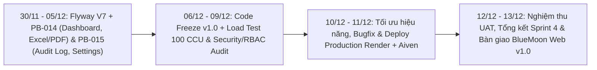

# 📋 KẾ HOẠCH CHI TIẾT SPRINT 4 (SPRINT 4 BACKLOG & EXECUTION PLAN)

> **Dự án:** Hệ thống Quản lý Chung cư BlueMoon — Phiên bản Web Server (v1.0)  
> **Môn học:** Nhập môn Công nghệ Phần mềm (IT3180) - SoICT, Đại học Bách Khoa Hà Nội  
> **Đơn vị thực hiện:** Nhóm 8 (Lớp 172881) — PM: **Hoàng Phúc Hưng** (`202416216`)  
> **Thời gian Sprint 4:** 30/11/2026 – 13/12/2026 (14 ngày)  
> **Tài liệu tham chiếu:** [agile_plan.md](./agile_plan.md), [sprint1.md](./sprint1.md), [sprint2.md](./sprint2.md) và [sprint3.md](./sprint3.md)  
> **Trạng thái Sprint:** ⚪ **To Do (Chuẩn bị triển khai — 0 / 13 SP)**

---

## 🎯 1. TỔNG QUAN, MỤC TIÊU & PHÂN CÔNG SPRINT 4

### 1.1. Mục tiêu cốt lõi (Sprint Goal)

> **"Hoàn thiện phân hệ Báo cáo – Kiểm toán và Nghiệm thu toàn hệ thống BlueMoon Web v1.0: Xây dựng Dashboard Thống kê trực quan & Xuất báo cáo Excel (Apache POI) / PDF (OpenPDF) trong $\le 5$ giây với 500 bản ghi, Hoàn thiện Nhật ký quản trị (Audit Log) – Soft Delete – Cấu hình đơn giá hệ thống, và thực hiện Kiểm thử phi chức năng (NFR 100 CCU, $\le 200\text{ ms}$ API, RBAC 403), kiểm thử chấp nhận (UAT) cùng BQL trên môi trường Render + MySQL Aiven."**

### 1.2. Thông số Sprint 4 (Sprint Metrics)

- **Tổng Story Points cam kết:** `13 SP` (Hoàn tất tổng **`69 / 69 SP`** của BlueMoon Web v1.0)
- **Số lượng Backlog Items:** `3 items` (`PB-014` – `PB-016` / `US-014` – `US-016`)
- **Epic liên quan:**
  - `EPIC-06`: Thống kê Báo cáo, Audit Log, Cấu hình Hệ thống & Nghiệm thu NFR/UAT
- **Hiện trạng triển khai (đồng bộ `agile_plan.md`):**
  - 📋 **To Do:** `13 SP` (`PB-014` 5 SP, `PB-015` 3 SP, `PB-016` 5 SP `AT RISK`)

### 1.3. Phân công 7 thành viên Sprint 4 (theo `README.md`)

| STT | Họ và tên | MSSV | Vai trò | Hạng mục phụ trách chính trong Sprint 4 |
| :---: | :--- | :---: | :--- | :--- |
| 1 | **Hoàng Phúc Hưng** | `202416216` | **PM / DevOps / Kiến trúc** | `PB-016` (Deploy chính thức Render + MySQL Aiven, giám sát CI/CD, điều phối UAT với BQL & tổng hợp hồ sơ bàn giao v1.0) |
| 2 | **Mai Huy Hoàng** | `202400046` | **Backend Developer** | `PB-015` (Flyway `V7`, API tra cứu/lọc Audit Log, tổng rà soát Soft Delete toàn hệ thống, bảng & API `system_configs`) |
| 3 | **Đỗ Tràng Minh Quân** | `202416320` | **Backend Developer** | `PB-014` (API tổng hợp số liệu Dashboard, xuất báo cáo Excel `.xlsx` bằng Apache POI & PDF biên lai/báo cáo bằng OpenPDF $\le 5\text{ s}$) |
| 4 | **Đào An Huy** | `202416223` | **Frontend Developer** | `PB-014` (Dashboard biểu đồ doanh thu theo đợt thu, tỷ lệ đóng phí, thẻ KPI hộ/nhân khẩu & nút tải Excel/PDF) |
| 5 | **Nguyễn Trung Khang** | *(Bổ sung sau)* | **Fullstack Developer** | `PB-015` (UI Xem/lọc Nhật ký kiểm toán `AuditLogsPage.jsx` & Cấu hình đơn giá hệ thống `SystemSettingsPage.jsx`) |
| 6 | **Nguyễn Đức Quang** | `202416327` | **Fullstack Developer** | `PB-014` & `PB-016` (Tối ưu truy vấn thống kê/bộ lọc công nợ, sửa lỗi phát sinh trong quá trình UAT) |
| 7 | **Phạm Ngọc Huy** | *(Bổ sung sau)* | **Fullstack / QA** | `PB-016` (Viết & chạy kịch bản load test k6/JMeter 100 CCU, kiểm thử bảo mật RBAC 403 toàn bộ endpoint, lập báo cáo NFR & UAT) |

---

## 🧩 2. KẾ THỪA TỪ SPRINT 1–3 & THIẾT KẾ KIẾN TRÚC MỞ RỘNG

### 2.1. Thành phần kế thừa sẵn có từ Sprint 1 – Sprint 3

- **Thư viện xuất báo cáo đã khai báo sẵn:** Trong [pom.xml](../server/pom.xml) đã tích hợp `org.apache.poi:poi-ooxml:5.4.0` (Excel `.xlsx`) và `com.github.librepdf:openpdf:1.4.2` (PDF `.pdf`).
- **Hạ tầng Audit Log:** Bảng `audit_logs` và AOP [AuditLogAspect.java](../server/src/main/java/com/hust/se/bluemoon/aspect/AuditLogAspect.java) đã ghi nhận xuyên suốt Sprint 1–3; Sprint 4 bổ sung API/UI tra cứu, lọc, phân trang và rà soát 100% thao tác quản trị.
- **Dữ liệu thống kê:** Đầy đủ từ các bảng `apartments`, `households`, `residents`, `billing_cycles`, `invoices`, `utility_readings`, `payment_transactions`, `parking_slots`, `complaints`.

### 2.2. Thiết kế Flyway Migration `V7__sprint4_system_config_indexes.sql`

- **`system_configs`** (`PB-015`): `id`, `config_key` (`VARCHAR(64) UNIQUE`), `config_value` (`VARCHAR(255) NOT NULL`), `description` (`VARCHAR(500)`), `updated_by` (FK `users`), `updated_at` (`TIMESTAMP`).
  - Seed cấu hình mặc định: `DEFAULT_ELECTRICITY_PRICE` (`3500`), `DEFAULT_WATER_PRICE` (`15000`), `DEFAULT_INTERNET_PRICE` (`200000`), `PARKING_MOTORBIKE_FEE` (`100000`), `PARKING_CAR_FEE` (`1200000`), `BUILDING_NAME` (`Chung cư BlueMoon`).
- **Tối ưu Index cho Báo cáo & NFR (`<= 200ms` API / `<= 5s` xuất file):**
  - `audit_logs`: `INDEX idx_audit_created_table (created_at, target_table)` và `INDEX idx_audit_user_action (user_id, action_name)`.
  - `invoices`: rà soát index `(billing_cycle_id, status)` phục vụ tổng hợp Dashboard nhanh.

### 2.3. Phân quyền RBAC & Menu động mở rộng

- **`ADMIN`:** Truy cập `/api/dashboard/**`, `/api/reports/**`, `/api/admin/audit-logs/**`, `/api/admin/settings/**` (chặn `RESIDENT` trả **HTTP 403**). Bổ sung 3 mục menu Sidebar trong `AuthService.buildMenusForRole` & [MainLayout.jsx](../client/src/layouts/MainLayout.jsx):
  - `Dashboard Thống kê` (`/dashboard` — trang chủ mặc định cho `ADMIN`)
  - `Nhật ký Quản trị` (`/admin/audit-logs`)
  - `Cấu hình Hệ thống` (`/admin/settings`)

---

## 📊 3. BẢNG THEO DÕI TIẾN ĐỘ SPRINT 4 (SPRINT TRACKING BOARD)

| AT RISK | ITEM | MÔ TẢ NGẮN | EPIC | PHỤ TRÁCH | SP | START | FINISH | TRẠNG THÁI | PHỤ THUỘC & GHI CHÚ |
| :---: | :--- | :--- | :---: | :--- | :---: | :---: | :---: | :---: | :--- |
| 🔴 | **Sprint 4** | **Dashboard Excel/PDF, Audit Log/Soft Delete, Test NFR 100 CCU & UAT** | `EPIC-06` | **Nhóm 8 (PM: Hưng)** | **13** | **30/11/2026** | **13/12/2026** | ⚪ **To Do** | Chốt bàn giao **BlueMoon Web v1.0** (`69/69 SP`) |
| 🟢 | **`PB-014` (`US-014`)** | Dashboard Thống kê & Xuất báo cáo Excel (Apache POI) / PDF (OpenPDF) | `EPIC-06` | Quân, An Huy, Quang | 5 | 30/11/2026 | 06/12/2026 | ⚪ **To Do** | Phụ thuộc dữ liệu `PB-008`..`PB-011` \| Ngưỡng $\le 5\text{ s}$ / 500 bản ghi |
| 🟢 | **`PB-015` (`US-015`)** | Nhật ký quản trị (Audit Log), hoàn thiện Soft Delete & Cấu hình đơn giá | `EPIC-06` | Hoàng, Khang | 3 | 30/11/2026 | 05/12/2026 | ⚪ **To Do** | Rà soát Soft Delete toàn bộ 12+ bảng nghiệp vụ |
| 🔴 | **`PB-016` (`US-016`)** | Kiểm thử NFR (100 CCU, $\le 200\text{ ms}$), RBAC 403, UAT & Deploy chính thức | `EPIC-06` | Ngọc Huy, Hưng, Quang | 5 | 06/12/2026 | 13/12/2026 | ⚪ **To Do** | *AT RISK:* Tối ưu truy vấn & kết nối Aiven chịu tải 100 CCU |

---

## 🔍 4. CHI TIẾT TỪNG HẠNG MỤC CÔNG VIỆC (WORK PACKAGES)

### 4.1. `PB-014` (`US-014` | `EPIC-06` | 5 SP): Dashboard Thống kê & Xuất báo cáo Excel / PDF

- **Thời gian:** 30/11/2026 – 06/12/2026
- **Trạng thái:** ⚪ **To Do**
- **Người phụ trách:** Đỗ Tràng Minh Quân (Backend/Export), Đào An Huy (Frontend Charts), Nguyễn Đức Quang (Query Optimization)
- **Tiêu chí chấp nhận (AC):**
  - Dashboard hiển thị đầy đủ chỉ số tổng quan: tổng căn hộ (`OCCUPIED`/`AVAILABLE`), tổng hộ `ACTIVE`, tổng nhân khẩu, tổng phải thu / đã thu / còn nợ theo đợt thu, tỷ lệ hoàn thành đóng phí (`%`), và biểu đồ doanh thu thực thu theo tháng.
  - **Xuất báo cáo Excel (`.xlsx` — Apache POI):** Xuất bảng tổng hợp công nợ / doanh thu theo kỳ thu (hỗ trợ lọc trạng thái `PAID`/`UNPAID`), giữ định dạng số tiền VNĐ, chữ căn trái, số căn phải.
  - **Xuất báo cáo / biên lai PDF (`.pdf` — OpenPDF):** Hỗ trợ font tiếng Việt đầy đủ dấu (UTF-8 TrueType font nhúng trong `resources/fonts/`), hiển thị rõ thông tin tòa nhà, kỳ thu, danh sách khoản mục và tổng tiền.
  - **Hiệu năng xuất file:** Thời gian xuất báo cáo Excel/PDF và vẽ biểu đồ **$\le 5$ giây** với $500$ bản ghi.
- **Nhiệm vụ cụ thể (Subtasks):**
  - [ ] **Backend Dashboard API:** `DashboardController` & `DashboardService` (`/api/dashboard/summary`, `/api/dashboard/revenue-by-period`) sử dụng truy vấn `GROUP BY` tối ưu, tránh N+1 query.
  - [ ] **Backend Export Excel/PDF:** `ReportController` & `ReportExportService` (`GET /api/reports/invoices/excel`, `GET /api/reports/invoices/pdf`, `GET /api/reports/invoices/{id}/receipt-pdf`) kèm nhúng font Unicode cho OpenPDF.
  - [ ] **Frontend UI:** Trang `DashboardPage.jsx` (thẻ KPI, biểu đồ cột/đường doanh thu & tỷ lệ thu, bộ lọc kỳ thu, nút Tải Excel / Tải PDF).
  - [ ] **QA/Test:** Integration Test xuất file `.xlsx` và `.pdf` hợp lệ, benchmark thời gian xuất 500 bản ghi $\le 5\text{ s}$, kiểm tra hiển thị dấu tiếng Việt trên PDF.

---

### 4.2. `PB-015` (`US-015` | `EPIC-06` | 3 SP): Nhật ký quản trị (Audit Log), Soft Delete & Cấu hình Hệ thống

- **Thời gian:** 30/11/2026 – 05/12/2026
- **Trạng thái:** ⚪ **To Do**
- **Người phụ trách:** Mai Huy Hoàng (Backend), Nguyễn Trung Khang (Frontend)
- **Tiêu chí chấp nhận (AC):**
  - BQL (`ADMIN`) xem, tìm kiếm và lọc `audit_logs` theo **người thực hiện**, **hành động (`action_name`)**, **bảng mục tiêu (`target_table`)** và **khoảng thời gian** có phân trang (`Pageable`).
  - Tổng rà soát 100% API xóa dữ liệu nghiệp vụ từ Sprint 1–3 đảm bảo sử dụng **Soft Delete** (`is_deleted = true`), không còn thao tác `DELETE` vật lý làm mất vết kiểm toán.
  - Quản lý **Cấu hình đơn giá mặc định** (`system_configs`): xem & cập nhật đơn giá điện, nước, internet, phí gửi xe mặc định; mọi thay đổi cấu hình đều ghi `@LogAudit`.
- **Nhiệm vụ cụ thể (Subtasks):**
  - [ ] **Database & Entity:** Tạo bảng `system_configs` và index `audit_logs` trong `V7__sprint4_system_config_indexes.sql`.
  - [ ] **Backend API:** `AuditLogController` (`/api/admin/audit-logs` phân trang & lọc) và `SystemConfigController` (`/api/admin/settings`: `GET`, `PUT` kèm `@LogAudit`); cập nhật `UtilityService` đọc đơn giá mặc định từ `system_configs`.
  - [ ] **Frontend UI:** Trang `AuditLogsPage.jsx` (bảng nhật ký có phân trang, bộ lọc đa điều kiện) và `SystemSettingsPage.jsx` (form cập nhật đơn giá hệ thống).
  - [ ] **QA/Test:** Test phân quyền RBAC 403, kiểm tra Audit Log tự động ghi khi sửa cấu hình hệ thống, rà soát Soft Delete toàn bộ repository.

---

### 4.3. `PB-016` (`US-016` | `EPIC-06` | 5 SP | `AT RISK`): Kiểm thử NFR, RBAC, UAT & Hoàn thiện Deploy Chính thức

- **Thời gian:** 06/12/2026 – 13/12/2026
- **Trạng thái:** ⚪ **To Do** _(AT RISK)_
- **Người phụ trách:** Phạm Ngọc Huy (QA/Load Test), Hoàng Phúc Hưng (DevOps/UAT), Nguyễn Đức Quang (Bugfix)
- **Tiêu chí chấp nhận (AC):**
  - **Kiểm thử tải & hiệu năng (`NFR-AC-02`):** Chạy kịch bản k6 / JMeter với **100 người dùng đồng thời (100 CCU)**:
    - Độ trễ API trung bình/p95 **$\le 200\text{ ms}$**.
    - Thời gian tải trang **$\le 2\text{ giây}$** với $1.000$ bản ghi.
    - Xuất báo cáo Excel/PDF **$\le 5\text{ giây}$** với $500$ bản ghi.
  - **Kiểm thử bảo mật (`NFR-AC-01`):** 100% endpoint quản trị trả **HTTP 403** với tài khoản `RESIDENT`, 100% endpoint không token trả **HTTP 401**, không tồn tại lỗi IDOR trên `/api/resident/**`.
  - **UAT & Deploy chính thức:** Triển khai ổn định trên **Render (Backend + Frontend)** kết nối **MySQL Aiven (SSL)**, hoàn tất biên bản kiểm thử chấp nhận (UAT) cho 16/16 User Stories (`US-001` – `US-016`).
- **Nhiệm vụ cụ thể (Subtasks):**
  - [ ] **Kịch bản Load Test:** Viết script k6/JMeter lưu tại `docs/testing/` mô phỏng 100 CCU (đăng nhập, tra cứu hóa đơn, xem dashboard, cổng cư dân).
  - [ ] **Tối ưu & Bugfix:** Tinh chỉnh HikariCP pool size, SQL index, phân trang và fix toàn bộ lỗi phát hiện qua Load Test / Security Audit.
  - [ ] **Deploy & UAT:** Cấu hình đầy đủ env vars trên Render + Aiven, chạy kiểm thử hồi quy toàn bộ `Sprint1`–`Sprint4` tests, thực hiện phiên UAT với BQL & lập báo cáo nghiệm thu.

---

## 📅 5. LỊCH TRÌNH THỰC HIỆN THEO NGÀY (30/11/2026 – 13/12/2026)

### Chi tiết các mốc ngày làm việc:
- **30/11 – 05/12 (Ngày 1–6):** Hoàn thành `V7__sprint4_system_config_indexes.sql`, hoàn tất `PB-015` (Audit Log, Soft Delete, System Settings) và phần cốt lõi `PB-014` (Dashboard + Export Excel/PDF).
- **06/12 – 09/12 (Ngày 7–10):** Hoàn thiện giao diện biểu đồ `PB-014`, **Code Freeze tính năng v1.0**, chạy kịch bản k6/JMeter 100 CCU và rà soát bảo mật RBAC 403 / IDOR (`PB-016`).
- **10/12 – 11/12 (Ngày 11–12):** Tối ưu SQL/HikariCP theo kết quả đo đạc, sửa triệt để lỗi UAT, deploy bản chính thức lên **Render + MySQL Aiven**.
- **12/12 – 13/12 (Ngày 13–14):** Thực hiện phiên **UAT** toàn bộ 16 User Stories, cập nhật tài liệu tổng kết dự án, họp **Sprint 4 Review & Retrospective** và bàn giao sản phẩm **BlueMoon Web Server v1.0**.

---

## 🔒 6. YÊU CẦU PHI CHỨC NĂNG NGHIỆM THU v1.0 (FULL NFR CHECKLIST)

Toàn bộ hệ thống bàn giao cuối Sprint 4 phải vượt qua đầy đủ 3 nhóm tiêu chuẩn từ [agile_plan.md](./agile_plan.md):

- **Bảo mật (`NFR-AC-01`):**
  - Mật khẩu băm **BCrypt**; phiên đăng nhập **JWT HS256** (hết hạn 24 giờ).
  - OTP lưu dạng băm trong `email_otps`, TTL 5 phút, gửi mail $\le 3\text{ giây}$.
  - Middleware RBAC (`ADMIN`/`RESIDENT`) chặn truy cập trái phép trả **HTTP 403** trong 100% trường hợp; chống IDOR trên toàn bộ `/api/resident/**`.
  - IPN VNPAY kiểm tra checksum **HMAC-SHA512** và đảm bảo **Idempotent**.
- **Hiệu năng (`NFR-AC-02`):**
  - Độ trễ phản hồi API **$\le 200\text{ ms}$**.
  - Thời gian tải trang **$\le 2\text{ giây}$** với $1.000$ bản ghi.
  - Chịu tải tối thiểu **$100$ người dùng đồng thời (CCU)**.
  - Xuất báo cáo Excel/PDF và vẽ biểu đồ **$\le 5\text{ giây}$** với $500$ bản ghi.
- **Toàn vẹn & Trải nghiệm (`NFR-AC-03`):**
  - Phân biệt rõ lỗi kết nối/thao tác CSDL (`DATABASE_ERROR`) với lỗi nhập liệu (`VALIDATION_ERROR`).
  - 100% thao tác xóa dữ liệu nghiệp vụ dùng **Soft Delete** và ghi **Audit Log**.
  - Giao diện Responsive, font **Arial 14px** màu đen trên nền trắng, chữ căn trái, số căn phải (`tabular-nums`).

---

## 🛡️ 7. QUẢN TRỊ RỦI RO SPRINT 4 (`AT RISK`)

| Mã Rủi Ro | Hạng mục liên quan | Nguy cơ / Mô tả Rủi ro | Mức độ | Kế hoạch Phòng ngừa & Giảm thiểu (Mitigation Plan) |
| :---: | :--- | :--- | :---: | :--- |
| **RSK-01** | `PB-014` (Excel / PDF) | Xuất PDF bằng OpenPDF bị lỗi mất dấu tiếng Việt hoặc vượt quá 5 giây với 500 bản ghi. | **Cao** | Nhúng sẵn font TrueType Unicode (`DejaVuSans.ttf` / `Arial.ttf`) trong `src/main/resources/fonts/`; tối ưu query lấy dữ liệu 1 lần (`JOIN FETCH`) trước khi ghi file. |
| **RSK-02** | `PB-016` (100 CCU) | Gói Render/Aiven bị nghẽn kết nối DB hoặc độ trễ API vượt 200 ms khi chạy 100 CCU. | **Cao** | Tinh chỉnh `spring.datasource.hikari.maximum-pool-size`, bổ sung composite index trong `V7`, warm-up server trước phiên đo tải & UAT. |
| **RSK-03** | `PB-015`, `PB-016` | Sót endpoint chưa gắn kiểm tra RBAC hoặc còn thao tác xóa cứng ở 1 module cũ. | **Trung bình** | Viết test tự động quét toàn bộ route quản trị với token `RESIDENT` (yêu cầu 100% trả 403) và rà soát toàn bộ `deleteById` trong codebase. |
| **RSK-04** | Phạm vi v1.0 | Phình phạm vi (Scope Creep) do thêm các tính năng thuộc Roadmap v2.0 (`PB-017` RFID, `PB-018` Khách thăm, `PB-019` MoMo). | **Thấp** | Giữ nghiêm kỷ luật Out-of-Scope theo `agile_plan.md`, tập trung 100% chất lượng và ổn định cho 16 Backlog Items của v1.0. |

---

## ✅ 8. ĐỊNH NGHĨA HOÀN THÀNH (DoD — 8 TIÊU CHÍ) & QUY ƯỚC GIT

### 8.1. Definition of Done (8 tiêu chí chuẩn từ `agile_plan.md`)

Một Backlog Item (`PB-014`..`PB-016`) chỉ được chuyển sang trạng thái **Done** khi đáp ứng đủ 8 tiêu chí:
1. Code đã được Review bởi ít nhất 01 thành viên khác và không còn lỗi compile/lint.
2. Vượt qua Unit Test và Integration Test cho các API / service cốt lõi.
3. Đáp ứng 100% **Acceptance Criteria (`AC`)** tương ứng của User Story.
4. Xử lý lỗi chuẩn: phân biệt rõ lỗi CSDL và lỗi validate nhập liệu.
5. Kiểm tra phân quyền RBAC ở tầng Middleware (trả HTTP 403 khi sai vai trò).
6. Áp dụng Soft Delete và ghi nhận Audit Log đầy đủ với thao tác quản trị.
7. Đạt các ngưỡng hiệu năng NFR ($\le 200\text{ ms}$ API, $\le 2\text{ s}$ tải trang, $\le 5\text{ s}$ xuất file, 100 CCU, giao diện Responsive).
8. Deploy chạy ổn định trên môi trường **Render + MySQL Aiven** và pass kiểm thử UAT.

### 8.2. Quy ước làm việc trên Repository (GitHub Flow)

- **Đặt tên nhánh (tạo trực tiếp từ `main` mới nhất):**
  - `feat/PB-014-dashboard-excel-pdf`
  - `feat/PB-015-audit-log-system-config`
  - `test/PB-016-nfr-load-test-uat`
- **Commit Message:** Gắn mã Backlog Item ở đầu commit:
  - `feat(PB-014): add revenue dashboard API and Apache POI / OpenPDF exports`
  - `test(PB-016): add k6 100 CCU load test script and RBAC 403 audit suite`
- **Pull Request (PR):** Tạo PR trực tiếp vào **`main`**, ghi rõ mã `PB-xxx` / `US-xxx`, danh sách `AC` & bằng chứng đo NFR/UAT, yêu cầu tối thiểu 1 reviewer approve trước khi merge.
