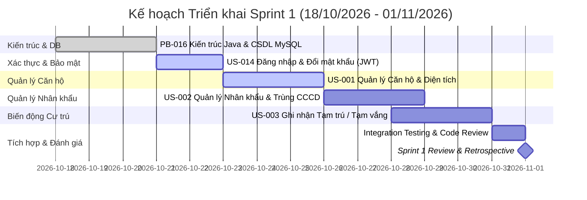

# 📋 KẾ HOẠCH CHI TIẾT SPRINT 1 (SPRINT 1 BACKLOG & EXECUTION PLAN)

> **Dự án:** Hệ thống Quản lý Chung cư BlueMoon (BlueMoon Apartment Management System)  
> **Môn học:** Nhập môn Công nghệ Phần mềm (IT3180) - SoICT, Đại học Bách Khoa Hà Nội  
> **Đơn vị thực hiện:** Nhóm 8 (Lớp 172881)  
> **Thời gian Sprint 1:** 18/10/2026 – 01/11/2026 (15 ngày)  
> **Ngày cập nhật:** 23/10/2026 (Giữa Sprint)  
> **Trạng thái Sprint:** 🟡 **In Progress (Đang thực hiện)**

---

## 🎯 1. TỔNG QUAN & MỤC TIÊU SPRINT 1 (SPRINT GOAL)

### 1.1. Mục tiêu cốt lõi (Sprint Goal)

> **"Thiết lập hoàn chỉnh nền tảng kiến trúc Client - Server (Spring Boot / MySQL & Vite React SPA), triển khai module Xác thực & Phân quyền người dùng (Đăng nhập, Đổi mật khẩu), và xây dựng các chức năng cốt lõi thuộc phân hệ Quản lý Căn hộ, Quản lý Nhân khẩu cùng Biến động Cư trú (Tạm trú / Tạm vắng)."**

### 1.2. Thông số Sprint 1 (Sprint Metrics)

- **Tổng Story Points cam kết:** `19 SP`
- **Số lượng User Stories / Tasks:** `5 tasks` (PB-016, US-014, US-001, US-002, US-003)
- **Tiến độ đến ngày 23/10/2026:**
  - ✅ **Đã hoàn thành (Done):** `5 SP` (PB-016 - Kiến trúc Java & CSDL MySQL đã hoàn tất)
  - 🔄 **Đang triển khai (In Progress):** `6 SP` (US-014 Đăng nhập/Đổi mật khẩu & US-001 Quản lý Căn hộ)
  - 📋 **Chờ triển khai (To Do):** `8 SP` (US-002 Quản lý Nhân khẩu & US-003 Tạm trú/Tạm vắng)
- **Epics liên quan:**
  - `EPIC-01`: Quản lý Cư dân & Căn hộ
  - `EPIC-05`: Bảo mật, Phân quyền & Quản trị Hệ thống

---

## 📊 2. BẢNG THEO DÕI TIẾN ĐỘ SPRINT 1 (SPRINT TRACKING BOARD)

| AT RISK | TASK NAME                                                           |      FEATURE TYPE       |      RESPONSIBLE       | STORY POINTS |     START      |     FINISH     |  DURATION   |       STATUS       | COMMENTS & PHỤ THUỘC                                                                                                                                |
| :-----: | :------------------------------------------------------------------ | :---------------------: | :--------------------: | :----------: | :------------: | :------------: | :---------: | :----------------: | :-------------------------------------------------------------------------------------------------------------------------------------------------- |
|   🟢    | **Sprint 1: Nền tảng Hệ thống & Quản lý Cư dân (EPIC-01, EPIC-05)** |      _Sprint Goal_      | **Nhóm 8 (Team Lead)** |    **19**    | **18/10/2026** | **01/11/2026** | **15 ngày** | 🟡 **In Progress** | **Mục tiêu:** Thiết lập kiến trúc Java/MySQL, Đăng nhập và Quản lý Hộ gia đình, Nhân khẩu, Tạm trú/Tạm vắng (19 SP).                                |
|   🟢    | **PB-016 (F-16) – Kiến trúc Desktop Java & CSDL MySQL**             |  Architecture _(Must)_  |      Backend / DB      |      5       |   18/10/2026   |   21/10/2026   |   3 ngày    |    🟢 **Done**     | Khởi tạo khung mã nguồn Spring Boot, kết nối CSDL MySQL (schema.sql), mapping JPA Entities, Spring Security JWT filter.                             |
|   🟡    | **US-014 (PB-014) – Đăng nhập & đổi mật khẩu**                      | Security / NFR _(Must)_ |       Fullstack        |      3       |   21/10/2026   |   23/10/2026   |   2 ngày    |    🟢 **Done**     | Phụ thuộc: DB Tài khoản (PB-016) \| AC-037..039 \| Task: Màn hình đăng nhập, mã hóa BCrypt, JWT Stateless, đổi mật khẩu định kỳ (RAW-025, 028).     |
|   🟡    | **US-001 (PB-001) – Quản lý hộ gia đình & diện tích**               |  Core Feature _(Must)_  |       Fullstack        |      3       |   23/10/2026   |   26/10/2026   |   3 ngày    | 🟡 **In Progress** | Phụ thuộc: PB-016, US-014 \| AC-001..003 \| Task: Thiết kế bảng hộ gia đình/căn hộ, form thêm căn hộ & validate diện tích > 0 (RAW-001).            |
|   🟢    | **US-002 (PB-002) – Quản lý nhân khẩu**                             |  Core Feature _(Must)_  |      Frontend/UI       |      5       |   26/10/2026   |   29/10/2026   |   3 ngày    | ⚪ **Not Started** | Phụ thuộc: US-001 \| AC-004..006 \| Task: Bảng nhân khẩu, form nhập liệu, dropdown quan hệ chủ hộ, kiểm tra trùng CCCD toàn tòa nhà (RAW-002, 003). |
|   🟢    | **US-003 (PB-003) – Ghi nhận tạm trú / tạm vắng**                   |  Core Feature _(Must)_  |       Backend/QA       |      3       |   28/10/2026   |   01/11/2026   |   3 ngày    | ⚪ **Not Started** | Phụ thuộc: US-001, US-002 \| AC-007..009 \| Task: Bảng biến động cư trú, form tạm trú/tạm vắng, validate ngày kết thúc >= bắt đầu (RAW-004, 005).   |

---

## 🔍 3. CHI TIẾT TỪNG HẠNG MỤC CÔNG VIỆC (TASK BREAKDOWN & WORK PACKAGES)

### 3.1. PB-016 (F-16): Kiến trúc Desktop Java & CSDL MySQL (5 SP)

- **Loại:** Architecture / NFR _(Must have)_
- **Thời gian:** 18/10/2026 – 21/10/2026
- **Trạng thái:** 🟢 **ĐÃ HOÀN THÀNH (Done)**
- **Người thực hiện:** Mai Huy Hoàng, Hoàng Phúc Hưng
- **Mục tiêu:** Xây dựng khung ứng dụng cơ sở, thiết lập cấu trúc Monorepo (`client/`, `server/`, `database/`, `docs/`), kết nối cơ sở dữ liệu MySQL và cấu hình Spring Boot với các tiêu chuẩn bảo mật.
- **Kết quả nghiệm thu:**
  - [x] Khởi tạo dự án Spring Boot 3.x với Java 21 LTS (`server/pom.xml`).
  - [x] Thiết lập script cơ sở dữ liệu `database/schema.sql` (bảng `users`, `apartments`, `residents`, `residency_logs`, `audit_logs`).
  - [x] Cấu hình kết nối MySQL và JPA (`application.yml` / `application.properties`).
  - [x] Xây dựng các Entity và Repository cốt lõi: [Apartment.java](file:///d:/CNPM/server/src/main/java/com/hust/se/bluemoon/entity/Apartment.java), [Resident.java](file:///d:/CNPM/server/src/main/java/com/hust/se/bluemoon/entity/Resident.java), [User.java](file:///d:/CNPM/server/src/main/java/com/hust/se/bluemoon/entity/User.java).
  - [x] Tích hợp AOP Audit Trail ([AuditLogAspect.java](file:///d:/CNPM/server/src/main/java/com/hust/se/bluemoon/aspect/AuditLogAspect.java)) và xử lý ngoại lệ tập trung ([GlobalExceptionHandler.java](file:///d:/CNPM/server/src/main/java/com/hust/se/bluemoon/config/GlobalExceptionHandler.java)).
  - [x] Thiết lập dự án Frontend React 19 + Vite (`client/`).

---

### 3.2. US-014 (PB-014): Đăng nhập & Đổi mật khẩu (3 SP)

- **Loại:** Security / NFR _(Must have)_
- **Thời gian:** 21/10/2026 – 23/10/2026
- **Trạng thái:** 🟡 **In Progress (Đang hoàn thiện tích hợp Frontend & Test)**
- **Người thực hiện:** Mai Huy Hoàng (Backend), Đào An Huy (Frontend)
- **Tiêu chí chấp nhận (Acceptance Criteria):**
  - **AC-037:** Người dùng đăng nhập bằng `username` và `password`. Nếu đúng, hệ thống trả về JWT Token và thông tin vai trò (`ROLE_ADMIN`, `ROLE_CASHIER`, `ROLE_RESIDENT_MANAGER`).
  - **AC-038:** Trường hợp sai thông tin đăng nhập quá 5 lần hoặc sai mật khẩu, hệ thống thông báo lỗi rõ ràng nhưng không để lộ chi tiết tài khoản. Mật khẩu lưu trong DB bắt buộc mã hóa BCrypt.
  - **AC-039:** Người dùng có thể đổi mật khẩu cá nhân; mật khẩu mới phải khác mật khẩu cũ, độ dài $\ge 6$ ký tự và cần nhập lại chính xác mật khẩu mới.
- **Nhiệm vụ cụ thể (Subtasks):**
  - [x] **Backend:** API `/api/auth/login` và `/api/auth/change-password` ([AuthController.java](file:///d:/CNPM/server/src/main/java/com/hust/se/bluemoon/controller/AuthController.java), [AuthService.java](file:///d:/CNPM/server/src/main/java/com/hust/se/bluemoon/service/AuthService.java)).
  - [x] **Backend:** Cấu hình Spring Security Filter & JJWT Provider ([JwtAuthenticationFilter.java](file:///d:/CNPM/server/src/main/java/com/hust/se/bluemoon/config/JwtAuthenticationFilter.java)).
  - [ ] **Frontend:** Thiết kế giao diện `LoginPage` (form đăng nhập hiện đại, thông báo lỗi bằng Toast/Alert).
  - [ ] **Frontend:** Lưu trữ Token an toàn (localStorage / sessionStorage), cấu hình interceptor cho `axiosClient.js` tự động gắn `Authorization: Bearer <token>`.
  - [ ] **Frontend:** Modal / Form Đổi mật khẩu định kỳ cho người dùng khi đăng nhập lần đầu.
  - [ ] **QA/Test:** Kiểm thử luồng đăng nhập thành công, đăng nhập thất bại và đổi mật khẩu qua Postman & UI.

---

### 3.3. US-001 (PB-001): Quản lý Hộ gia đình & Diện tích Căn hộ (3 SP)

- **Loại:** Core Feature _(Must have)_
- **Thời gian:** 23/10/2026 – 26/10/2026
- **Trạng thái:** 🟡 **In Progress (Bắt đầu xây dựng UI & hoàn thiện Service)**
- **Người thực hiện:** Nguyễn Trung Khang (Fullstack), Đào An Huy (Frontend)
- **Tiêu chí chấp nhận (Acceptance Criteria):**
  - **AC-001:** Hiển thị danh sách toàn bộ căn hộ trong tòa nhà (Mã căn hộ, Tầng, Diện tích, Tên chủ hộ, Số điện thoại chủ hộ, Trạng thái: EMPTY / OCCUPIED).
  - **AC-002:** Cho phép thêm mới căn hộ / hộ gia đình. Ràng buộc diện tích căn hộ `area > 0` ($m^2$); mã căn hộ là duy nhất (Unique) trên toàn tòa nhà (ví dụ: `P101`, `P102`).
  - **AC-003:** Cho phép tìm kiếm/tra cứu căn hộ theo mã căn hộ hoặc tên chủ hộ với thời gian đáp ứng $< 3$ giây (đã tạo DB Index `idx_apartment_code`).
- **Nhiệm vụ cụ thể (Subtasks):**
  - [x] **Database:** Bảng `apartments` có check constraint `area > 0` và index `idx_apartment_code`.
  - [x] **Backend:** API GET `/api/apartments`, GET `/api/apartments/{id}`, POST `/api/apartments` ([ApartmentController.java](file:///d:/CNPM/server/src/main/java/com/hust/se/bluemoon/controller/ApartmentController.java)).
  - [ ] **Backend:** Bổ sung API PUT `/api/apartments/{id}` (cập nhật thông tin chủ hộ/diện tích) và tìm kiếm căn hộ theo keyword.
  - [ ] **Frontend:** Xây dựng trang `ApartmentListPage` với bảng dữ liệu hỗ trợ tìm kiếm, phân trang và bộ lọc trạng thái.
  - [ ] **Frontend:** Modal form "Thêm căn hộ mới" với validation chặt chẽ (diện tích > 0, số điện thoại đúng định dạng 10 số, mã phòng không để trống).
  - [ ] **QA/Test:** Kiểm thử validation khi nhập diện tích âm, mã căn hộ trùng lặp.

---

### 3.4. US-002 (PB-002): Quản lý Nhân khẩu (5 SP)

- **Loại:** Core Feature _(Must have)_
- **Thời gian:** 26/10/2026 – 29/10/2026
- **Trạng thái:** ⚪ **Not Started (Sẵn sàng triển khai sau US-001)**
- **Người thực hiện:** Nguyễn Trung Khang (Fullstack), Đào An Huy (Frontend)
- **Tiêu chí chấp nhận (Acceptance Criteria):**
  - **AC-004:** Hiển thị danh sách nhân khẩu theo từng căn hộ/hộ gia đình: Họ tên, Ngày sinh, Giới tính, Số CCCD, Quan hệ với chủ hộ, Tình trạng cư trú.
  - **AC-005:** Form thêm nhân khẩu mới: Dropdown chọn quan hệ với chủ hộ (`Chủ hộ`, `Vợ`, `Chồng`, `Con`, `Bố`, `Mẹ`, `Khác`). Ràng buộc: Mỗi căn hộ chỉ có duy nhất 1 chủ hộ tại một thời điểm.
  - **AC-006:** Kiểm tra trùng số CCCD (12 ký tự số): Hệ thống lập tức chặn và báo lỗi nếu số CCCD đã tồn tại ở bất kỳ căn hộ nào trong toàn bộ tòa nhà.
- **Nhiệm vụ cụ thể (Subtasks):**
  - [x] **Backend:** Model [Resident.java](file:///d:/CNPM/server/src/main/java/com/hust/se/bluemoon/entity/Resident.java) và API cơ bản POST `/api/residents`, GET `/api/residents/apartment/{id}`.
  - [ ] **Backend:** Logic kiểm tra trùng CCCD (`residentRepository.existsByCccdNumber(...)`) và kiểm tra tính hợp lệ của mối quan hệ chủ hộ.
  - [ ] **Backend:** API cập nhật thông tin nhân khẩu (PUT) và xóa/chuyển nhân khẩu ra khỏi căn hộ (DELETE/Deactivate).
  - [ ] **Frontend:** Giao diện chi tiết căn hộ hiển thị danh sách thành viên hộ gia đình.
  - [ ] **Frontend:** Form "Thêm nhân khẩu" với regex validate CCCD (12 chữ số) và select quan hệ với chủ hộ.
  - [ ] **QA/Test:** Test case kiểm tra trùng CCCD nội bộ căn hộ và giữa các căn hộ khác nhau; test case nhập sai định dạng ngày sinh, CCCD thiếu số.

---

### 3.5. US-003 (PB-003): Ghi nhận Tạm trú / Tạm vắng (3 SP)

- **Loại:** Core Feature _(Must have)_
- **Thời gian:** 28/10/2026 – 01/11/2026
- **Trạng thái:** ⚪ **Not Started (Chờ phụ thuộc US-001, US-002)**
- **Người thực hiện:** Đỗ Trọng Minh Quân (Backend), Nguyễn Đức Quang (Fullstack/QA)
- **Tiêu chí chấp nhận (Acceptance Criteria):**
  - **AC-007:** Ghi nhận biến động cư trú cho nhân khẩu (Khai báo Tạm trú hoặc Khai báo Tạm vắng).
  - **AC-008:** Ràng buộc thời gian: Ngày kết thúc phải lớn hơn hoặc bằng ngày bắt đầu (`end_date >= start_date`). Ghi nhận rõ lý do biến động.
  - **AC-009:** Tự động đồng bộ trạng thái cư trú của nhân khẩu (`residence_status`) trong bảng `residents` sang `TAM_TRU` hoặc `TAM_VANG`. Có thể trích xuất danh sách biến động phục vụ nộp báo cáo Công an phường.
- **Nhiệm vụ cụ thể (Subtasks):**
  - [x] **Backend:** Bảng `residency_logs` và API POST `/api/residents/residency-log` ([ResidentController.java](file:///d:/CNPM/server/src/main/java/com/hust/se/bluemoon/controller/ResidentController.java)).
  - [ ] **Backend:** Validate nghiệp vụ logic thời gian `startDate <= endDate`, kiểm tra trạng thái hiện tại của cư dân trước khi chuyển đổi.
  - [ ] **Frontend:** Tab/Modal "Khai báo Biến động Cư trú" (chọn loại: Tạm trú / Tạm vắng, Date picker ngày bắt đầu, ngày kết thúc, trường nhập lý do).
  - [ ] **Frontend:** Bảng lịch sử biến động cư trú của nhân khẩu kèm nhãn trạng thái trực quan (Badge màu sắc).
  - [ ] **QA/Test:** Kiểm thử biên: Chọn ngày kết thúc trước ngày bắt đầu, khai báo tạm vắng cho nhân khẩu không tồn tại.

---

## 📅 4. LỊCH TRÌNH THỰC HIỆN THEO NGÀY (DAILY SPRINT SCHEDULE)

### Chi tiết các mốc ngày làm việc:

- **18/10 – 21/10 (Ngày 1 - 3):**
  - Khởi tạo repo, phân quyền nhánh Git Flow (`develop`, `feature/*`).
  - Viết `schema.sql`, tạo database MySQL, tạo các Entity và kết nối Spring Boot.
  - _Kết quả:_ PB-016 nghiệm thu thành công ngày 21/10.
- **21/10 – 23/10 (Ngày 4 - 6):**
  - Hoàn thiện AuthService, mã hóa BCrypt, cấu hình JwtTokenProvider.
  - Xây dựng giao diện Login React, kết nối Axios gọi API đăng nhập.
  - _Mục tiêu ngày 23/10:_ Chốt tính năng US-014.
- **23/10 – 26/10 (Ngày 6 - 9):**
  - Hoàn thiện trọn vẹn CRUD Căn hộ (ApartmentService, Controller, Repository).
  - Xây dựng UI Danh sách Căn hộ, Form thêm căn hộ có validate diện tích `area > 0`.
- **26/10 – 29/10 (Ngày 9 - 12):**
  - Xây dựng phân hệ Quản lý Nhân khẩu, dropdown quan hệ chủ hộ.
  - Cài đặt cơ chế kiểm tra trùng lặp CCCD 12 số trên toàn hệ thống.
  - Tích hợp UI chi tiết thành viên căn hộ.
- **28/10 – 31/10 (Ngày 11 - 14):**
  - Xây dựng tính năng Ghi nhận Tạm trú / Tạm vắng (ResidencyLog).
  - Validation ngày bắt đầu và kết thúc (`end_date >= start_date`).
  - Viết Integration Tests và chuẩn bị tài liệu bàn giao.
- **31/10 – 01/11 (Ngày 14 - 15):**
  - Freeze code, chạy kiểm thử tích hợp toàn bộ luồng Sprint 1.
  - Họp **Sprint Review** (Demo chức năng với Giảng viên/Nhóm) & **Sprint Retrospective** (Rút kinh nghiệm cho Sprint 2).

---

## 🛡️ 5. QUẢN TRỊ RỦI RO (RISK MANAGEMENT)

| Mã Rủi Ro  | Nguy cơ / Mô tả Rủi ro                                         |     Mức độ     | Kế hoạch Phòng ngừa & Giảm thiểu (Mitigation Plan)                                                                                                                                                |
| :--------: | :------------------------------------------------------------- | :------------: | :------------------------------------------------------------------------------------------------------------------------------------------------------------------------------------------------ |
| **RSK-01** | Trùng lặp CCCD do nhập liệu đồng thời từ nhiều nguồn           |    **Cao**     | Thiết lập Unique Index `idx_resident_cccd` ở tầng DB MySQL, kết hợp bắt ngoại lệ `DataIntegrityViolationException` tại `GlobalExceptionHandler`.                                                  |
| **RSK-02** | Xung đột Merge Code khi nhiều bạn cùng làm Frontend Client     | **Trung bình** | Chia nhỏ thành các component riêng biệt (`ApartmentTable.jsx`, `ResidentModal.jsx`), tuân thủ Git Flow: mỗi task một branch `feature/fe-*` riêng, tạo PR và review trước khi merge vào `develop`. |
| **RSK-03** | Hết hạn Token hoặc mất trạng thái đăng nhập khi F5 trình duyệt | **Trung bình** | Cấu hình lưu JWT an toàn trong localStorage kèm thời hạn hợp lý, có Axios interceptor tự động bắt mã lỗi 401/403 để điều hướng về `/login`.                                                       |
| **RSK-04** | Trễ hạn chặng cuối (US-002 và US-003 dồn vào cuối Sprint)      |    **Cao**     | Bắt đầu song song Backend cho US-002 ngay khi US-001 hoàn thành phần API; phân bổ Đỗ Trọng Minh Quân hỗ trợ viết test và kiểm thử nghiệp vụ cư trú.                                               |

---

## ✅ 6. ĐỊNH NGHĨA HOÀN THÀNH (DEFINITION OF DONE - DoD)

Một User Story được coi là **HOÀN THÀNH (DONE)** trong Sprint 1 khi và chỉ khi:

1. **Source Code:** Mã nguồn được commit theo chuẩn Conventional Commits và merge vào nhánh `develop` thông qua Pull Request được duyệt (ít nhất 1 reviewer phê duyệt).
2. **Database:** Mọi trường dữ liệu và ràng buộc (Unique, Check, Foreign Key) hoạt động chính xác, không gây lỗi deadlock hoặc vi phạm toàn vẹn dữ liệu.
3. **Acceptance Criteria:** Vượt qua 100% các tiêu chí chấp nhận được định nghĩa trong tài liệu SRS (AC-001 đến AC-009, AC-037 đến AC-039).
4. **Testing:** Đã thực hiện kiểm thử chức năng (Happy path, Edge case, Invalid input) trên cả Postman và giao diện người dùng Web React.
5. **Logging:** Các thao tác quan trọng (thêm căn hộ, sửa cư dân, đổi mật khẩu) được ghi nhận nhật ký hệ thống qua [AuditLogAspect](file:///d:/CNPM/server/src/main/java/com/hust/se/bluemoon/aspect/AuditLogAspect.java).
